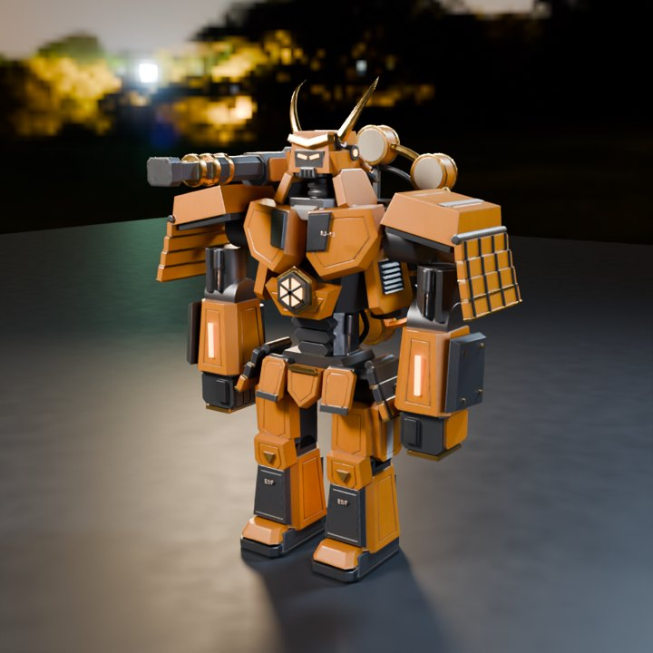
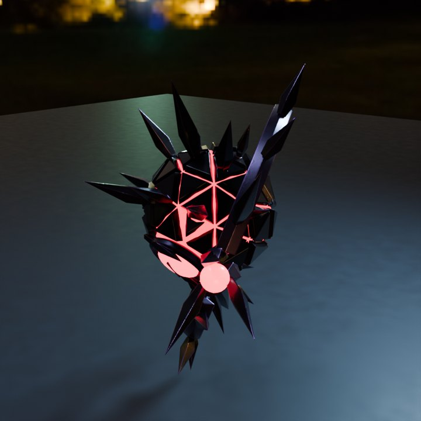

# ART_PIPELINE — アート仕様と3D制作パイプライン

すべてオリジナル。既存アニメ・ゲーム・実在ロボット・商標ロゴを模倣しない。**ロボットに ₿ 記号を付けない**。
大画面の遠距離から「太く重い橙＝雷神」「細身で俊敏な青緑＝風神」「墨黒と赤い侵蝕光＝敵」が形だけで判別できること。
雷神と風神は**同じ側に並ぶ仲間**、敵（NULL CORE と Corruptor）は正面奥。

## パレット

| 用途   | 雷神 RAIJIN                | 風神 FUJIN                       | 侵蝕体（敵）               |
| ------ | -------------------------- | -------------------------------- | -------------------------- |
| 識別色 | 琥珀 `#F7931A`             | 青緑 `#25C8D7`                   | 侵蝕赤 `#FF3B5C`           |
| 主装甲 | 黒鉄 `#161B20` / 琥珀橙    | 青紺 `#102836`                   | 墨黒 `#0B0A12`             |
| 副装甲 | 銅 `#8C573A`・金 `#B88738` | 銀白 `#D7E4E8`・補助青 `#3289DF` | 紫 `#B65CFF`（アクセント） |
| 発光   | `#FFB547`（機能部分のみ）  | `#25C8D7`                        | `#FF3B5C`（弱点・予告）    |
| 記号   | ⚡ 雷鼓                    | 🌀 風環                          | —                          |

UI：黒紺 `#070D1A`、オフホワイト `#EFF5FF`。

## シルエット

- **雷神**：肩幅が広い逆三角、厚い胸装甲、巨大な拳、太い足首。背面に**雷鼓型の動力炉**（金の輪＋太鼓）。Bitcoin 要素は「ブロックの積層・鎖の結合」を装甲の意匠に抽象化（PoW を機体で計算しているとは主張しない）。
- **風神**：細身・長い脚・流線型の肩と腕、背面に**分割式の風環リング**と刃状の翼、常に少し浮遊。表面に分岐・合流する**ノード回路**の発光。
- **NULL CORE**：浮遊する巨大な球核、周囲に装甲片の輪、**独立部品の弱点**（コア・腕・脚にあたる部位）。被弾で装甲片が開き内部光が見える（流血・人体表現なし）。
- **Corruptor（護衛）**：偵察機（小さな八面体）、砲撃機（大型）、妨害機（青い発光）。侵蝕赤の発光点で味方と区別。

## 共通スケルトン（Blender ボーン名 = three.js ジョイント名）

`Root, Hips, Spine, Chest, Neck, Head, UpperArm_L/R, Forearm_L/R, Hand_L/R, Thigh_L/R, Shin_L/R, Foot_L/R` ＋ `BackUnit`（Chest の子）。

- 原点：足元中央（Root）。+Y 上、**+Z 前**、1 unit = 1 m 相当。ロボットの左 = +X。
- 仕様書 D3 の `Pelvis` `Shoulder_L/R` は `Hips` と `UpperArm` の根元で兼ねている（D-038）。

## アニメーション（クリップ名は両機共通）

`Idle, Intro, AttackLight, AttackHeavy, Guard, HitReact, Special, Victory, Defeat, Walk, Dash, Hover, ShieldDeploy, Charge, Boarding, HitHeavy`
（手続きリグと Blender GLB の両方）。仕様書 D1/D2 の名前 `Punch` `HeavyAttack` `HitLight` は GLB に**別名トラック**として入り、
それぞれ AttackLight / AttackHeavy / HitReact と同じ動き（D-063）。必須アニメの一覧は `REQUIRED_CLIPS`（`director.ts`）。
存在しないクリップは `packages/three-game/src/robots/animate.ts` の手続きアニメにフォールバックする。
モーションの確認用コンタクトシート（各6フレーム）とチャージの GIF：`docs/art/motion/{raijin,fujin}_{motion.png,charge.gif}`。

## ダメージ段階（仕様 D1：色を塗らず、ひびと開いた装甲で見せる）

| 段階 | 機体HP  | 見た目                           | ノード名    |
| ---- | ------- | -------------------------------- | ----------- |
| 0    | 70%〜   | 無傷                             | —           |
| 1    | 40〜69% | 胸のひびから機体色の内部光       | `damage1_*` |
| 2    | 〜39%   | 胸板が浮いて光が漏れる、肩のひび | `damage2_*` |

GLB では既定で非表示、ゲームが `damageStageFor(health)` で切り替える。プレビュー：`docs/art/{raijin,fujin}_damaged.png`。
群衆が数秒ごとに操作するため、攻撃・被弾クリップは短く、途中で上書きされても破綻しない動きにする。

## エフェクトとカメラ（実装済み）

- 機能に紐づくエフェクト：砲撃の雷撃ビーム（雷神→敵）、風神のシールドドーム（都市）、エネルギーの流れ（中継→機体/予備電源）、
  修理の光、予告中の都市の赤い警告、攻撃の衝撃、神雷風陣（雷と風の柱→ボス）。
- カメラプリセット：intro / overview / boss / mapFocus / special / final / cockpit と短い演出用の cityDefense / gunnerImpact /
  routerPulse / repairRecovery / specialCharge（`packages/three-game/src/layout.ts`）。`arena.glb` に同じ位置のカメラ `cam_*` を入れてある。
- エフェクトの参照形状：`effects.glb`（シールドドーム・雷・風の帯・警告リング・ヌルビーム）。ゲーム内のエフェクトはコードで描画。
- 見せ方（D-070）：
  - 光：発光部分のにじみ（ブルーム）、周囲の映り込み（画像ファイルなしの手続き環境光：上の白、左の琥珀、右の青緑、奥の赤）、
    衝撃の瞬間だけ周囲を照らす光。
  - 粒子：にじむ火花（速いものは尾を引く）、火球、立ちのぼる残り火、煙、転がる装甲片。
  - 雷撃・ヌルビームは太さのある光の帯。
  - 打撃の手応え：ヒットストップ（重い一撃で 0.06〜0.18 秒だけ演出を止める）。打撃はクリップのヒットマーカー（`CLIP_HIT_TIME`）に合わせる。
  - 大きな場面のカメラワークとシネマバー：神雷風陣（成功・不完全・失敗）、ボス出現、ボス撃破、都市陥落。
  - 音：左右の定位（雷神は左、風神は右）、合成の残響、重低音の衝撃音、戦況で厚くなる BGM。
- 画質ごとの負荷（`QUALITY_SETTINGS`）：
  - 低：後処理なし、粒子を減らす。
  - 中：ブルームを半分の解像度で。
  - 高：フル解像度のブルームと色にじみ、煙・破片・照明を増やす。
- **光過敏配慮**：
  - 全面の白フラッシュなし（画面中央を少し明るくするだけ）。
  - 点滅と画面の光は2Hz以下。
  - reduced motion で揺れ・点滅・画面の光・カメラワークを止める。
  - 画面揺れ量は設定可能。

## アリーナ

円形の舞台、中央に日本列島のホログラム（8都市ノード・HP・シールド・警告ラベル）、外周の門柱（抽象的な鳥居風の発光）、星空。
雷神は左、風神は右、NULL CORE は正面奥の上空。機体内のコックピット（仕様 D4）は舞台の下（`COCKPIT_POSITION`）に置き、
役割ごとの座席群をインスタンス描画する（D-056）。

Blender 版 `arena.glb`：舞台と外周リング、両機の出撃台（`spawn_RAIJIN/FUJIN`）、地図の台座と枠、8拠点の柱（`base_<地域>`、警告リング付き）、
照明塔、抽象的な街並みの遠景と波の意匠。`?models=blender` で手続きの舞台の代わりに使う（星空は共通、失敗時は手続きの舞台）。

## アセットの置き場所と形式

- ロボット GLB：`apps/web/public/assets/robots/<raijin|fujin>.glb` ＋ `manifest.json`（なければ `generated/` を探す。どちらもなければ手続きモデル）。
- glTF 2.0、メートル単位、+Y up、前方 +Z（Blender は書き出し時に変換）。
- 予算：各ロボ 30k〜80k tri を目安（会場GPUでFPSを測って決める）、ボーン ≤ 64、テクスチャ ≤ 2K（baseColor / ORM / normal / emissive）。
- 検査：`node tools/blender/inspect_glb.mjs <file.glb>`（ボーン名・クリップ名・tri数）。テスト：`tools/blender/test/inspect_glb.test.ts`。

## 制作パイプライン

1. **手続きモデル（現在の既定）**：`packages/three-game/src/robots/build.ts`（雷神・風神）、`Enemies.tsx`（NULL CORE・護衛）。
   GPU・外部ツールなしで動く。
2. **手続きリグの GLB 書き出し**：`pnpm --filter @sats-wars/three-game export-glb` → `apps/web/public/assets/robots/generated/`（gitignore）。
   GLB の読み込み経路の試験用。
3. **Blender（bpy, headless）**：`python tools/blender/generate_assets.py`（`pip install bpy==5.2.3` の Python 3.13、または
   `blender --background --python-exit-code 1 --python tools/blender/generate_assets.py`）。出力：
   - 編集可能な原本 `assets/blender/{raijin,fujin,null_core,arena,effects}.blend`（上書きせず版管理）
   - ゲーム用 `apps/web/public/assets/models/blender/*.glb` と `manifest.json`（RAIJIN/FUJIN/BOSS/ARENA/EFFECTS。
     骨格・16クリップ＋仕様名3つ/ボス5クリップ・PBR・弱点ノード・ダメージノード・カメラ）
   - 4方向プレビュー `docs/art/*_{front,side,back,three_quarter}.png`、ダメージ版 `*_damaged.png`、アリーナ・エフェクトの斜め俯瞰、
     モーションのコンタクトシート（Pillow があれば。`--no-motion` で省略）、統計 `docs/art/asset_report.json`
   - 会場画面では `/arena?models=blender`（または S の設定）で使う。既定はコード生成モデル（D-047）
   - 検証：`node tools/blender/inspect_glb.mjs <robot.glb>`、ボスは `--boss`、アリーナは `--arena`。`packages/three-game/src/glb.test.ts` が three.js で読み込み・再生を確認
4. **人間のアーティストによる仕上げ**：会場品質の造形・アニメーションは自動生成では足りない。上の命名と座標系を守れば差し替えられる。
   発注用の仕様（クリップの長さとヒットマーカー、予算、納品場所、自動検収）は `docs/art/ART_BRIEF.md`。

有料の3D生成AIは使わない（承認後に選択可）。外部素材を入れる場合は `assets/LICENSES.md` に出所・ライセンス・来歴を記録する。

## 会場用ヒーロー（D-074）

会場の大画面の既定は、Blender で作り直した雷神と NULL CORE（`apps/web/public/assets/models/hero/`、`?models=hero`）。
骨格・クリップ名・ダメージ段階・弱点の名前は上の契約のまま（検収は `packages/three-game/src/glb.test.ts`）。

- 生成：`tools/blender/hero_kit.py`（面取り・V 溝のパネル線・押し出し装甲・円柱・管・通気口・ボルト・ステンシル、手続き塗装）と
  `tools/blender/hero_assets.py`（組み立て→UV 展開→Cycles で 2K ベイク→骨ごとの剛体メッシュ→GLB）。ソースは
  `assets/blender/hero_*.blend` とベイク画像 `assets/blender/hero_textures/`。
- テクスチャ：基本色（エッジの剥げ・溝の汚れ）、ORM（R=AO・G=粗さ・B=金属）、接空間の法線。JPEG で GLB に埋め込み（雷神 5.7MB）。
- 雷神の追加ノード：`Cannon`（右肩のレールキャノン、胸の骨に付く）と `Muzzle`（砲口、エフェクトの起点）。
  攻撃クリップ（AttackHeavy/AttackLight）は肩砲の「構え→照準→反動」。
- NULL CORE：Idle・Telegraph は輪がちょうど1回転して継ぎ目なくループ（輪は非対称なので部分回転だと跳ねる）。
  ゲームでは Idle に Telegraph・HitReact を加算レイヤーで重ねる。
- プレビュー：`docs/art/hero_*.jpg`。

 

## 外部素材

| 素材                                              | 使い道                         | 出典・ライセンス                                                                                      |
| ------------------------------------------------- | ------------------------------ | ----------------------------------------------------------------------------------------------------- |
| `apps/web/public/assets/env/moonless_golf_1k.hdr` | 会場の舞台の映り込み（環境光） | Poly Haven「Moonless Golf」（CC0）。three.js リポジトリ `examples/textures/equirectangular/` から取得 |

ほかの形・テクスチャ・音はすべてこのリポジトリのコードで生成したもの。
