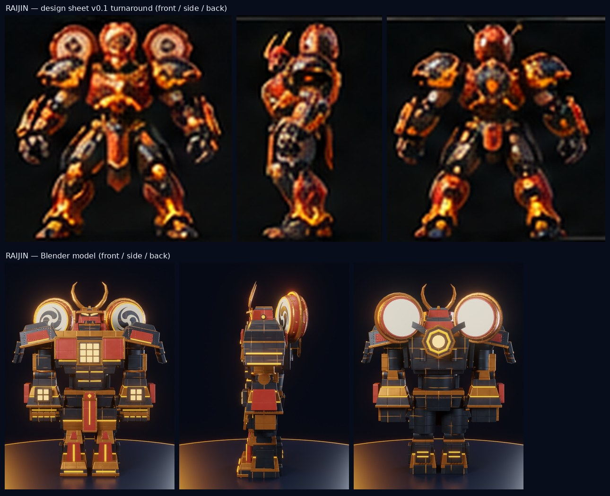
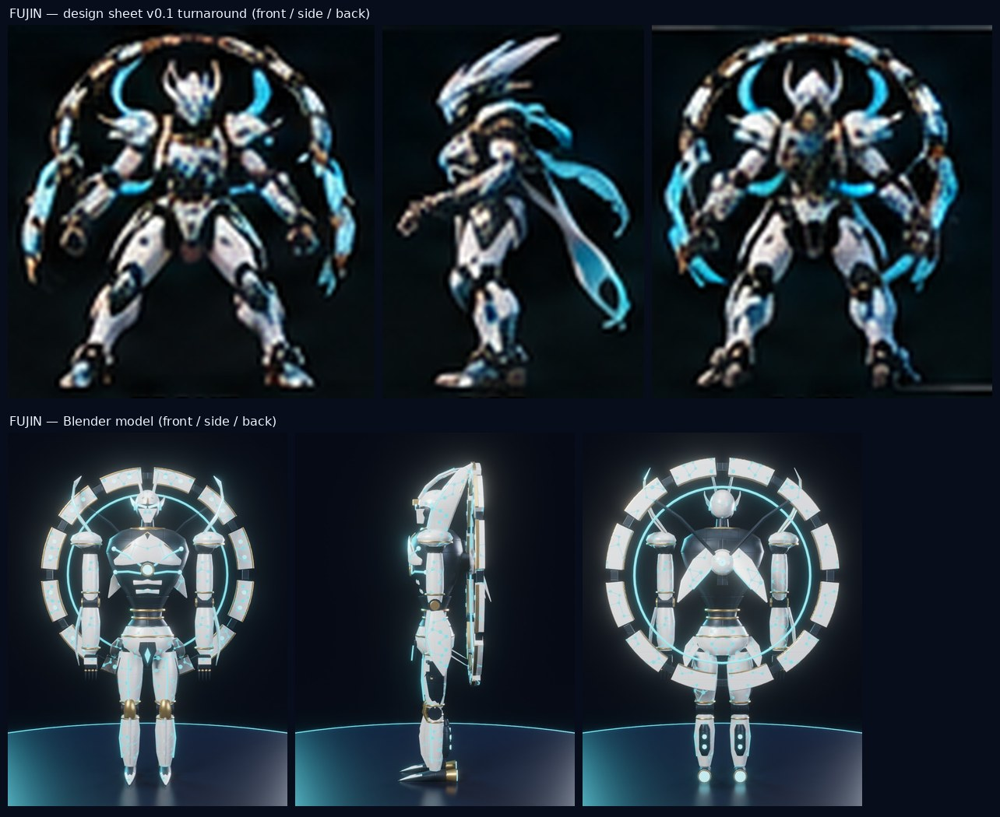
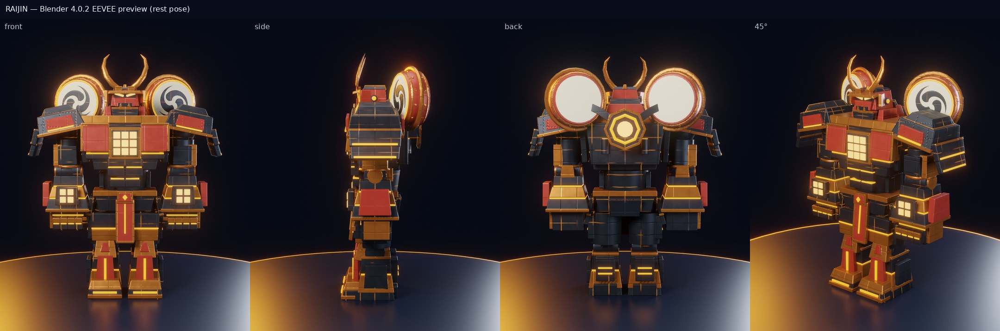
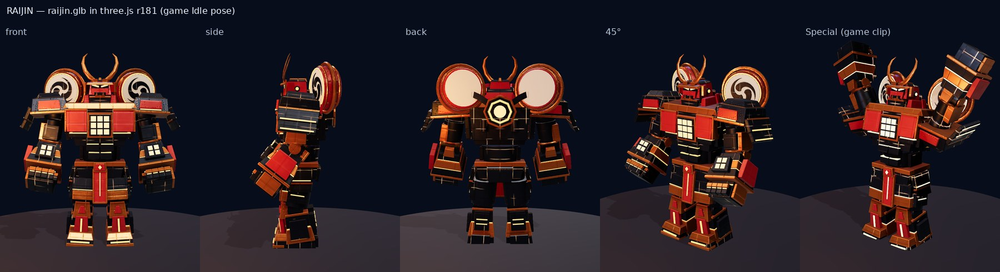
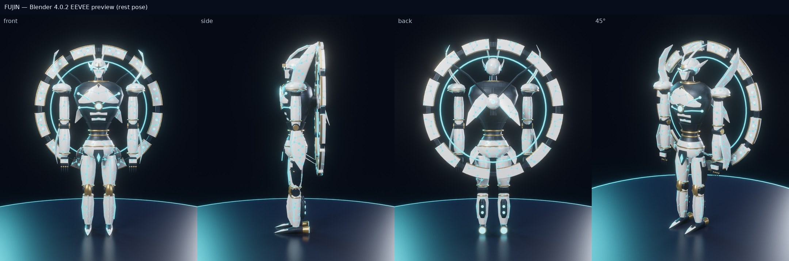
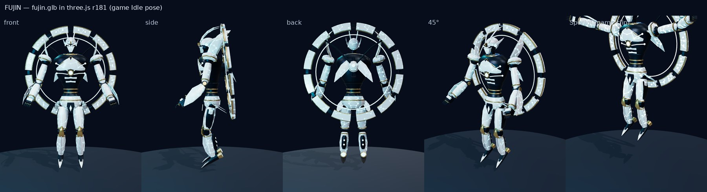
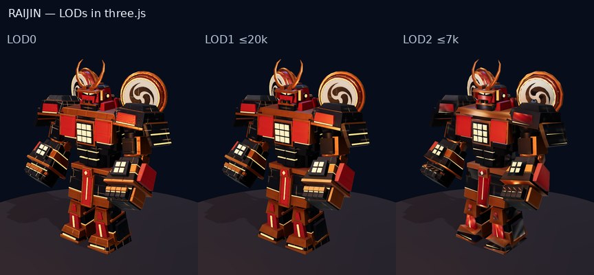
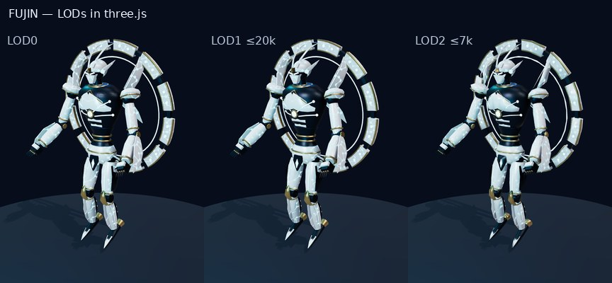
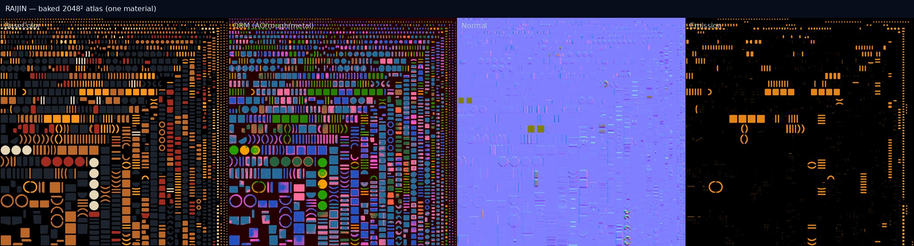
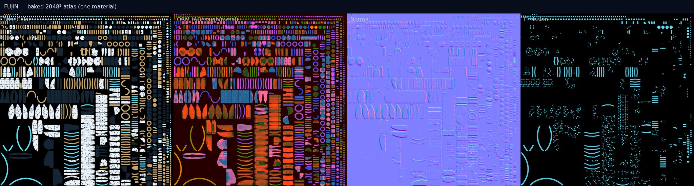

# RAIJIN / FUJIN 3Dモデル 制作レポート（v2：設定画準拠・Blender bpy 生成）

作成：2026-10-28　生成：`tools/blender/build_robot.py --robot all`（Blender 4.0.2 CLI、ヘッドレス、所要 28 分）

**造形のマスター：[`docs/design/visual-bible-v01/`](../design/visual-bible-v01/)**（設定画 3 枚＋`DESIGN_RULES_FOR_BLENDER.md`）。
v1 はこの設定画を見落として既存の手続き型モデルを参考にしていたため、設定画に合わせて作り直した
（経緯：[RAIJIN_BASE_REVIEW.md](RAIJIN_BASE_REVIEW.md)、DECISION_LOG D-027〜030）。

## 1. 成果物

| #   | 成果物                                    | 場所                                                                                                                                                                            |
| --- | ----------------------------------------- | ------------------------------------------------------------------------------------------------------------------------------------------------------------------------------- |
| 1   | `raijin.blend` / `fujin.blend`            | `assets/models/raijin/raijin.blend`（5.9 MB）, `assets/models/fujin/fujin.blend`（6.7 MB）                                                                                      |
| 2   | `raijin.glb` / `fujin.glb`（＋LOD1/LOD2） | `apps/web/public/assets/robots/`：`raijin.glb` 3.6 MB, `raijin_lod1.glb` 1.4 MB, `raijin_lod2.glb` 0.8 MB, `fujin.glb` 3.1 MB, `fujin_lod1.glb` 1.6 MB, `fujin_lod2.glb` 0.8 MB |
| 3   | プレビュー（正面・側面・背面・45°）       | `assets/models/<robot>/previews/<robot>_{front,side,back,45}.jpg`（1080×1350）                                                                                                  |
| 4   | Blender Python 生成スクリプト             | `tools/blender/build_robot.py`, `robots/raijin.py`, `robots/fujin.py`, `robotkit/*`, `validate_robot.py`（[README](../../tools/blender/README.md)）                             |
| 5   | three.js 表示テスト                       | `tools/model-viewer`（ビューア＋Playwright テスト。`pnpm models:test`）                                                                                                         |

ビューアを手で開く：`pnpm --filter @sats-wars/model-viewer build && node tools/model-viewer/serve.mjs` →
http://localhost:4173/tools/model-viewer/dist/index.html （`?robot=raijin&lod=1` など。クリップ・視点・ワイヤーフレーム切替あり）

## 2. 設定画との比較



| 項目（設定画／ルール）                              | モデル                                                                                                    | 判定                                             |
| --------------------------------------------------- | --------------------------------------------------------------------------------------------------------- | ------------------------------------------------ |
| 形状固定：二本角・幅広の肩・巨大な拳・左右の雷鼓2基 | 三日月形の銅の二本角、段積みの大きな肩、3段ブロックの巨大前腕と拳、肩の後方に雷鼓2基                      | ◎                                                |
| 雷鼓：太鼓型・三つ巴・円盤が回転                    | 朱の胴・銅の箍と鋲24個・生成り色の鼓面に三つ巴（ジオメトリ）・縁の発光リング。`Drum_L/R` ボーンで自軸回転 | ◎                                                |
| 積層ブロック（PoW）：腕脚を関節で分割、継ぎ目が発光 | 前腕3段・すね2段・腿2段のブロック。黒鉄のパネル継ぎ目が琥珀に発光（ベイク）                               | ◎                                                |
| 胸：計算炉のように繰り返す発光タイル                | 銅枠の中に 3×3 の発光タイル、前腕にも 2×2 の発光窓                                                        | ○ 設定画の胸は朱の装甲が主体。テキスト仕様を優先 |
| 顔：二本角・ひさし状の仮面                          | 朱の兜、下向きに尖った銅のひさし、つり目の発光、鬼面の牙、吹返し                                          | ◎                                                |
| 配色：黒鉄 / 銅装甲 / 発光琥珀 / 朱                 | #1E242D / #BC682A / #FF951A / #A42B20 をそのまま使用                                                      | ◎                                                |
| 低重心・頭が肩に埋まる                              | 首周りの装甲（喉輪）で頭を肩の間に沈めた。関節位置はゲームと同一のため頭の高さ自体は変えていない          | ○                                                |
| 肩の形                                              | 設定画は丸みのある段積み。仕様の「四角い装甲ブロックを積層」に合わせ角張らせた                            | △ 好みで丸みを足せる                             |
| 雷・鎖・浮遊する光の箱                              | モデルには入れない（ルール：稲妻はパーティクル/シェーダ）                                                 | ◎                                                |



| 項目（設定画／ルール）                                                  | モデル                                                                                                                                 | 判定                                                     |
| ----------------------------------------------------------------------- | -------------------------------------------------------------------------------------------------------------------------------------- | -------------------------------------------------------- |
| 形状固定：分割風環1基・流線型の仮面・細長い脚・両肩から流れる翼状パーツ | 12分割の風環（白磁のタイル＋金の縁＋シアンの発光点、濃紺の連結具）、尖った白磁の仮面、細長い脚、両肩から頭の横へ立ち上がる三日月形の翼 | ◎                                                        |
| 風環は独立ボーンで回転                                                  | `WindRing` ボーンで自軸回転。補助の背面フィン `BackFin_L/R`                                                                            | ◎                                                        |
| LN 意匠：ノード状の発光点を細いルートで接続                             | 白磁シェル全体に「発光ノード＋最近傍をつなぐ細線」の網をベイク（実在トポロジーではない）                                               | ◎                                                        |
| 顔：細い二本角・俊敏な仮面                                              | 後方へ流れる細い二本角（発光する稜線）、つり目、金の額飾り                                                                             | ◎                                                        |
| 体型：小さめの胸郭・細身・長脚                                          | 胸を v1 より小さくし、腰を絞り、脚は手続き型リグと同じ長さ                                                                             | ○ 設定画ほどの極端な長脚ではない（関節位置がゲーム準拠） |
| 配色：白磁 / 濃紺金属 / チャネル光 / 金属の縁                           | #EBF1F7 / #152534 / #5CDEFA / #C7A56C                                                                                                  | ◎                                                        |
| 脚部スラスター                                                          | ふくらはぎのポッドに発光ノズル2つ＋踵ブースター                                                                                        | ◎                                                        |
| 風の帯・布状パーツ                                                      | モデルには入れない（ルール：エフェクトで表現）。v1 の半透明チューブは削除                                                              | ◎                                                        |

## 3. 完成モデル






両機とも文字・ロゴなし（₿ マークも不使用。三つ巴は伝統文様をコードで描いたもの）。

## 4. 構造（リギング・アニメーション対応）

| 項目                     | RAIJIN                                                                | FUJIN                                      |
| ------------------------ | --------------------------------------------------------------------- | ------------------------------------------ |
| オブジェクト             | 30（Head / Torso / Arms / Legs / Joints / BackUnit の各コレクション） | 31                                         |
| ボーン                   | 33                                                                    | 34                                         |
| 追加ボーン（設計ルール） | 指×10、肩装甲×2、`Drum_L/R`                                           | 指×10、肩装甲×2、`WindRing`、`BackFin_L/R` |

- ゲーム用19関節の名前と位置は手続き型リグと同一。手足に沿ったボーン、ローカル X ＝ ワールド +X。
- 全頂点がちょうど1本のボーンに 100%（剛体スキン）。指は手のオブジェクト内で指ごとのボーンに分けている。
- 雷鼓・風環は自分の軸（ボーンの +Y）で回るボーン。three.js 側は `SPIN_BONES` を見つけると BackUnit の代わりにそれらを回す
  （必殺技で雷鼓が高速回転、風環が揺れる）。
- GLB にクリップは入れず、ゲームの手続き型クリップ9種で動く。設定書のクリップ名との対応は DECISION_LOG D-030。

## 5. ゲーム向け最適化

|                                 | RAIJIN                                                 | FUJIN  | 予算（設計ルール） |
| ------------------------------- | ------------------------------------------------------ | ------ | ------------------ |
| LOD0 三角形                     | 26,200                                                 | 18,086 | ≤ 50,000           |
| LOD1 三角形（1024² テクスチャ） | 11,484                                                 | 15,606 | ≤ 20,000           |
| LOD2 三角形（512² テクスチャ）  | 6,702                                                  | 6,692  | ≤ 7,000            |
| マテリアル                      | 1                                                      | 1      |                    |
| テクスチャ                      | 2048² × 4（BaseColor / ORM / Normal / Emission）、WebP | 同左   | ≤ 2K               |






## 6. 検証結果（すべてこのコンテナで実行）

| 検証                                                                               | 結果                                                                                                                                                                                                                       |
| ---------------------------------------------------------------------------------- | -------------------------------------------------------------------------------------------------------------------------------------------------------------------------------------------------------------------------- |
| `build_robot.py --robot all`（Blender 4.0.2）                                      | 終了コード 0（.blend 保存・GLB/LOD 書き出し・プレビュー描画）                                                                                                                                                              |
| `validate_robot.py --robot all`：保存した .blend / GLB / LOD を開き直して検証      | RAIJIN **OK**（28 項目） / FUJIN **OK**（28 項目）                                                                                                                                                                         |
| Khronos glTF-Validator 2.0.0-dev.3.10                                              | LOD0・LOD1・LOD2 の6ファイルとも **エラー 0・警告 0**                                                                                                                                                                      |
| `pnpm models:test`（Playwright・Chromium/SwiftShader・three.js r181）              | **8/8 通過**：glTF-Validator（LOD 含む）、GLB 読込・33/34 ボーン・単一マテリアル・4方向の描画、手続き型9クリップ×3時刻で全関節がゲーム内リグと一致（最大誤差 3.1×10⁻⁷ m）、必殺技で雷鼓/風環が回転、LOD1/LOD2 の予算と描画 |
| `pnpm test`（GLB 構造・LOD 予算の Node テスト、glbRig/回転ボーンの単体テスト含む） | 通過                                                                                                                                                                                                                       |
| bpy 5.2.3 LTS で同じスクリプトを実行                                               | LOD0〜2 を生成→ `validate_robot.py` 2体 OK、glTF-Validator 6ファイルともエラー 0・警告 0                                                                                                                                   |

## 7. 残課題

- アリーナでは未採用（`apps/web/public/assets/robots/manifest.json` を置くと切替。オーナー判断、D-026）。LOD 切替もゲーム未組込み。
- 会場 GPU での FPS 計測。設定画のアリーナ（鳥居・石段・浮遊灯籠・LED リング）の 3D 化は未着手。
- 設定画との残差：雷神の肩の丸み、風神の極端な長脚（ゲームの関節位置に合わせたため）。
- KTX2 圧縮、オリジナルのベイク済みアニメーション（Walk / Dash など）、人間アーティストによる最終造形。

## 8. 再生成

```bash
pnpm models:build --robot all       # = blender -b --factory-startup -P tools/blender/build_robot.py -- --robot all
pnpm models:validate --robot all
pnpm models:test
```
