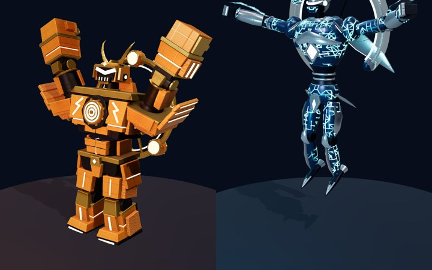
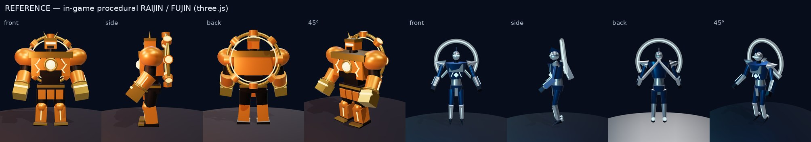

# RAIJIN / FUJIN 3Dモデル 制作レポート（Blender・bpy 生成）

作成：2026-10-28　生成：`tools/blender/build_robot.py --robot all`（Blender 4.0.2 CLI、ヘッドレス、所要 26 分）

基本モデルのレビュー（参考との違い・改善点）は [RAIJIN_BASE_REVIEW.md](RAIJIN_BASE_REVIEW.md)。本書はその改善を反映した
詳細化版と FUJIN の結果をまとめる。

## 1. 成果物

| # | 成果物 | 場所 |
|---|---|---|
| 1 | `raijin.blend` / `fujin.blend` | `assets/models/raijin/raijin.blend`（6.3 MB）, `assets/models/fujin/fujin.blend`（5.9 MB） |
| 2 | `raijin.glb` / `fujin.glb` | `apps/web/public/assets/robots/raijin.glb`（3.9 MB）, `fujin.glb`（2.3 MB） |
| 3 | プレビュー（正面・側面・背面・45°） | `assets/models/<robot>/previews/<robot>_{front,side,back,45}.jpg`（1080×1350） |
| 4 | Blender Python 生成スクリプト | `tools/blender/build_robot.py`, `robots/raijin.py`, `robots/fujin.py`, `robotkit/*`, `validate_robot.py`（[README](../../tools/blender/README.md)） |
| 5 | three.js 表示テスト | `tools/model-viewer`（ビューア＋Playwright テスト。`pnpm models:test`） |

ビューアを手で開く：`pnpm --filter @sats-wars/model-viewer build && node tools/model-viewer/serve.mjs` →
http://localhost:4173/tools/model-viewer/dist/index.html （ロボット・GLB/手続き型・クリップ・視点・ワイヤーフレーム切替）

## 2. 実行環境の確認結果

- download.blender.org はこのコンテナのネットワークポリシーで遮断（403）。Ubuntu apt の **Blender 4.0.2** を導入し、
  `blender -b -P` で .blend 保存・GLB 書き出し・Cycles/EEVEE/Workbench 描画がヘッドレスで動くことを確認。
  （apt 版は numpy と Mesa EGL が別途必要、OpenImageDenoise なし。）
- 互換確認として PyPI の **bpy 5.2.3 LTS**（Blender 5.2 をモジュール化したもの）でも同じスクリプトで2体を生成し、
  `validate_robot.py` と Khronos glTF-Validator がともにエラー0・警告0。
- GPU なし（ソフトウェア描画）。会場 GPU での描画速度は未計測。

## 3. RAIJIN 雷神


- **重装甲・ブロック構造**：装甲を独立したブロックの積み重ねで構成し、ブロック間の継ぎ目が琥珀色に発光。
  パネルラインは法線マップにベイク。
- **太鼓型動力炉**：胸の中央に、八角ハウジング・鼓胴（樽形）・金の縁と8つの鋲・同心円の金環・発光する鼓面。
- 兜型の頭部（山形の琥珀バイザー、反った金の角、吹返し、しころ、口元の発光スリット）、大袖型の2段の肩、頭ほどの拳
  （装甲の指＋金のナックルガード＋発光帯）、すねは2段ブロック（下段が広がる臑当て形）。
- 背面：金の輪＋8つの雷太鼓（鼓面が前後に発光）、スポークとハブ。`BackUnit` ボーンで回転。
- 青海波（せいがいは）の浮き彫りを肩・脇腹・背板・前腕・すねの一部パネルに。**オレンジ発光**（#FFB547 / コア #FFD27A）。

## 4. FUJIN 風神


- **流線型装甲**：胸・腰・手足を旋盤（lathe）とロフトで作った滑らかなシェルにし、くびれた胴の細身シルエット。
- **背面リング**：半透明の風袋チューブ（下部を60°開けたリング、別マテリアル）、銀の枠、発光する内輪、7つの結び目、
  刃状の翼2枚（発光する縁）、ハブと支柱。`BackUnit` ボーンで揺れる。
- **ネットワーク状の発光回路**：紺の装甲に、コード生成した回路網パターン（0/45/90°の配線とパッド）を
  大きなノイズで「まだら」にマスクして発光させる（全面を埋めず、紺地が見える）。
- 尖った銀の肩フィン、前腕の風刃（発光する前縁）、尖った足先と踵ブースター（発光ノズル）、回り込むバイザー、
  後方へ流れるトサカと側面フィン。**青緑の発光**（#25C8D7 / ベール #7FE9F2）。

両機とも文字・記号・ロゴは使っていない（ビットコインの「B」マークも不使用。検証スクリプトでテキストオブジェクトが無いことを確認）。

## 5. 構造（リギング・アニメーション対応）

| 項目 | 内容 |
|---|---|
| オブジェクト | 各29。コレクション別：Head / Torso（胸・脊椎・骨盤）/ Arms（肩アーマー・上腕・前腕・拳）/ Legs（腿・すね・足）/ Joints（首・肩・肘・股・膝）/ BackUnit |
| スケルトン | 19ボーン。名前は three.js のジョイント名と同一、関節位置はゲーム内の手続き型リグと完全一致。手足に沿った向き・ローカルX＝ワールド+X（肘膝は X 軸回り）。ボーンコレクション Body / Arm.L/R / Leg.L/R / BackUnit |
| スキン | 各パーツをボーン名の頂点グループに 100%（剛体）＋Armature モディファイア。モディファイアは Mirror → Bevel → Triangulate(n角形のみ) → Armature で非破壊のまま保存 |
| アニメーション | GLB にクリップは入れていない。ゲームは手続き型クリップ（Idle〜Defeat の9種）で動かし、同名クリップを GLB に入れればそちらが優先 |

ゲーム側の対応：`packages/three-game/src/robots/glbRig.ts` が GLB ボーンのレスト向きを記録し、`applyClip` が
手続き型の回転をその向きに変換して適用する（ボーンの向きが違っても世界座標での動きは同一）。
FUJIN の暗いベールと明るい本体の発光比も保つ。



## 6. ゲーム向け最適化

| | RAIJIN | FUJIN |
|---|---|---|
| 三角形 | 26,776 | 15,624 |
| マテリアル | 1（`RJ_Body`） | 2（`FJ_Body`＋半透明 `FJ_Veil`） |
| テクスチャ | 2048² × 4（BaseColor / ORM / Normal / Emission）、WebP | 同左 |
| 描画コール（パーツ数） | 29 | 29 |
| GLB | 3.9 MB | 2.3 MB |

- 面取り（Bevel）はウェイトで「12cm 以上の箱型・板パーツの硬いエッジ」だけに限定。丸物・鋲・発光帯は面取りしない
  （背面リングだけで 31k → 7.7k 三角形に削減）。
- 全パーツを1枚の UV アトラスに詰め、Cycles で4種をベイクして1マテリアル化。鏡像パーツは UV を重ねて解像度を節約。
  ORM の R に AO を入れ、glTF の occlusion として出力。法線マップ用に MikkTSpace 接線を同梱。
- 元の手続きマテリアル（パネルライン・青海波・回路網・面取り法線）は .blend に残してあり、形を変えたら再ベイクできる。


## 7. 検証結果（すべてこのコンテナで実行）

| 検証 | 結果 |
|---|---|
| `build_robot.py --robot all`（Blender 4.0.2） | 終了コード 0（.blend 保存・GLB 書き出し・プレビュー描画） |
| `validate_robot.py --robot all`：保存した .blend と GLB を開き直して 24 項目 | 2体とも **OK**（`assets/models/<robot>/<robot>_validation.json`） |
| Khronos glTF-Validator 2.0.0-dev.3.10 | 2体とも **エラー 0・警告 0・情報 0** |
| `pnpm models:test`（Playwright・Chromium/SwiftShader・three.js r181） | **6/6 通過**：GLB 読込、19ボーン・29スキンパーツ・テクスチャ・高さ、4方向の描画、手続き型9クリップ×3時刻で全関節がゲーム内リグと一致（最大誤差 3.1×10⁻⁷ m） |
| `pnpm test`（GLB 構造の Node テスト、glbRig の単体テスト含む） | 通過 |
| bpy 5.2.3 LTS で生成→検証 | 2体とも OK、glTF-Validator 0/0 |

## 8. 参考（ゲーム内の手続き型モデル）との比較と残課題



- 骨格・比率・配色・背面装備の役割は参考と同じ。形はユーザー指定に合わせて変更：雷神は丸い肩→ブロック構造、
  白い球のコア→太鼓型動力炉。風神は円柱の組み合わせ→流線型シェル、半透明アーチ→ほぼ一周の風袋リング＋回路網の発光。
- **アリーナでは未採用**：`apps/web/public/assets/robots/manifest.json` を置くと既定で GLB に切り替わる
  （`{"RAIJIN":"raijin.glb","FUJIN":"fujin.glb"}`）。会場の見た目を変えるためオーナー判断とした（DECISION_LOG D-026）。
- 残課題：
  - 会場 GPU での FPS 計測（2体で 58 描画コール＋影、テクスチャ合計 2048²×8 枚）。重ければ ORM/Emission を 1024² に落とす。
  - FUJIN のアトラスはリング状の長い UV 島が場所を取り、詰め込み効率が低い（約1/4が空き）。リングに継ぎ目を入れて分割すると改善。
  - KTX2（Basis）圧縮で GPU メモリを削減（toktx が必要）。LOD は未作成。
  - 指は固定（握り拳）。表情・指の動き、ベイク済みのオリジナルアニメーション、人間アーティストによる最終造形は未実施。

## 9. 再生成

```bash
pnpm models:build --robot all           # = blender -b --factory-startup -P tools/blender/build_robot.py -- --robot all
pnpm models:validate --robot all
pnpm models:test
```
