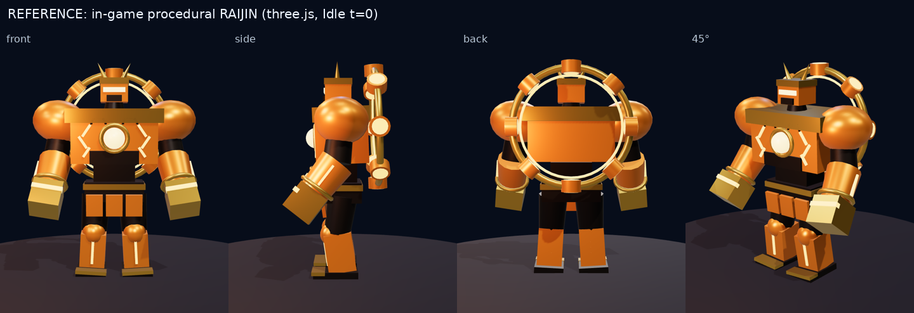
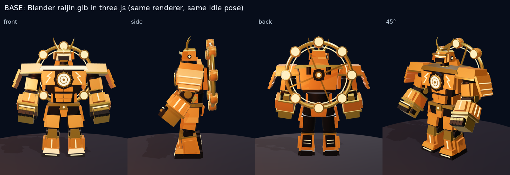
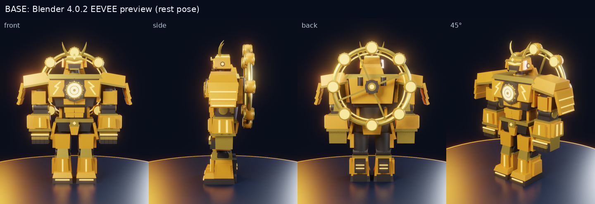

# RAIJIN 基本モデル レビュー（詳細化前チェックポイント）

作成：2026-10-28　対象：`tools/blender/build_robot.py --robot raijin --stage base` の出力

## 1. 参考資料について

リポジトリ内に設定画の**画像ファイルは存在しない**（全ブランチを確認済み）。そのため次の2つを「設定画」として扱った。

1. `docs/ART_BIBLE.md` のシルエット・配色・パーツ指定（文章の設定画）
2. 現行ゲームの手続き型ロボット `packages/three-game/src/robots/build.ts`（設定画を立体化した既存モデル）。
   three.js で同じ4方向から撮影した画像を基準にした（下図上段）。

## 2. 比較画像（同じ three.js レンダラー・同じ Idle 姿勢 t=0）

参考（ゲーム内の手続き型 RAIJIN）

基本モデル（Blender 製 `raijin.glb` を three.js で表示。アニメーションはゲームの手続き型クリップをそのまま適用）

基本モデル（Blender 4.0.2 EEVEE プレビュー、レスト姿勢）

## 3. 基本モデルの構成

| 項目 | 値 |
|---|---|
| オブジェクト | 29（頭・首・胸・腰・骨盤・肩アーマー・上腕・前腕・拳・腿・すね・足・各関節・背面リング・背面マウント） |
| ボーン | 19（`Root…Foot_R` ＋ `BackUnit`。名前と関節位置は手続き型リグと完全一致） |
| スキニング | 各パーツを1ボーンに100%ウェイト（剛体）。頂点グループ名＝ボーン名、Armature モディファイア |
| 三角形 | 18,328（うち背面リング 11,460 ← 鋲が重い） |
| マテリアル | 5（Armor / Gold / Iron / Glow / Core）、テクスチャなし |
| 書き出し | `.blend` 保存・GLB 書き出しともエラーなし。`inspect_glb.mjs` OK |

## 4. 参考との違い

| 部位 | 参考（手続き型・アートバイブル） | 基本モデル | 判定 |
|---|---|---|---|
| 全体シルエット | 逆三角・肩が大きい・拳が頭大 | 同じ骨格・同じ比率。肩幅は約4.1m とやや広い | ◎ |
| 肩 | 橙の大きな球 | ブロック構造の大袖（天板＋3段の板）。指示「ブロック構造の装甲」に合わせて変更 | ○ 正面から天板が薄い板に見える |
| 胸の動力炉 | 白い球のコア | **太鼓型動力炉**（胴・鋲・金の縁・発光する鼓面、八角ハウジング） | ◎ ただし鋲が歯車の歯に見える |
| 胸の稲妻 | 胸両側のジグザグ発光 | 胸板ブロックに稲妻の発光インレイ | ○ |
| 頭 | 箱型兜・金の角2本・**琥珀バイザーが目立つ** | 兜・吹返し・しころ・反った角・額の菱形 | △ **バイザーが眉庇に隠れてほぼ見えない** |
| 拳 | 金の大きな立方体 | 金の手の甲＋黒鉄の指ブロック | △ 正面から暗く小さく見える |
| 背面 | 金の輪＋8つの太鼓（放射状） | 金の輪＋8つの太鼓（鼓面が前後を向き発光）＋スポーク・ハブ | ◎ 正面からも鼓面の光輪が見える |
| 発光量 | コアと稲妻が強く光る | 細い発光線のみで全体に控えめ | △ |
| 質感 | 単色 | 単色・面取りなし（CG 的に硬い） | △ 詳細化で対応 |
| ロゴ | なし | なし（ビットコインの「B」等の記号は一切なし） | ◎ |

## 5. 改善点（詳細化フェーズで実施）

1. **バイザー**：眉庇を上げて琥珀の山形バイザーを前に出し、発光を強くする。
2. **拳**：指ブロックを装甲色＋金のナックルガードにし、正面の発光帯を太く。
3. **肩**：天板に厚みと稜線を付け、前後にも板を足して「重装甲の塊」に見せる。
4. **動力炉**：鋲を減らし鼓胴を前に出す。鼓面に同心円の発光リングを追加し、歯車に見えないようにする。
5. **ブロック構造の強調**：ブロック間の継ぎ目に橙の発光ライン（雷が走る隙間）を入れる。
6. **面取り**：Bevel モディファイア（ハードンノーマル）で縁にハイライトを出す。
7. **テクスチャ**：全パーツを1枚の UV アトラスにまとめ、Cycles で AO・パネルライン・発光をベイク（ゲーム用に1マテリアル化して描画コールを削減）。
8. **最適化**：背面リングの鋲をローポリ化し、合計 4万三角形以下（目標 30–60k の範囲内）を維持。

## 6. 検証済み / 未検証

- ✅ Blender 4.0.2（apt版）CLI でヘッドレス生成・保存・GLB 書き出し・EEVEE レンダーが成功
- ✅ three.js（r181）で GLB を読み込み、ゲームの手続き型アニメーションで正しく動く（ボーンの向きの差は `glbRig.ts` で吸収、ユニットテストあり）
- ⬜ 会場 GPU での描画速度（このコンテナは SwiftShader のみ）
- ⬜ 人間アーティストによる造形の最終判断
