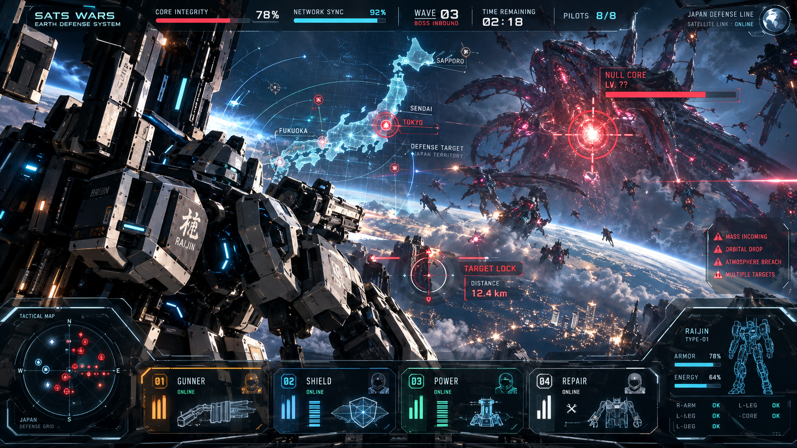
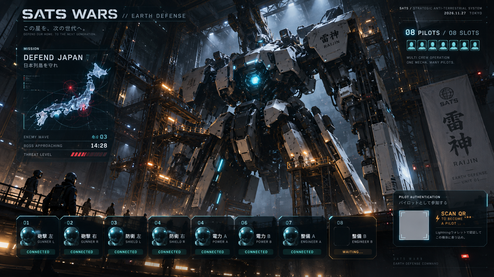
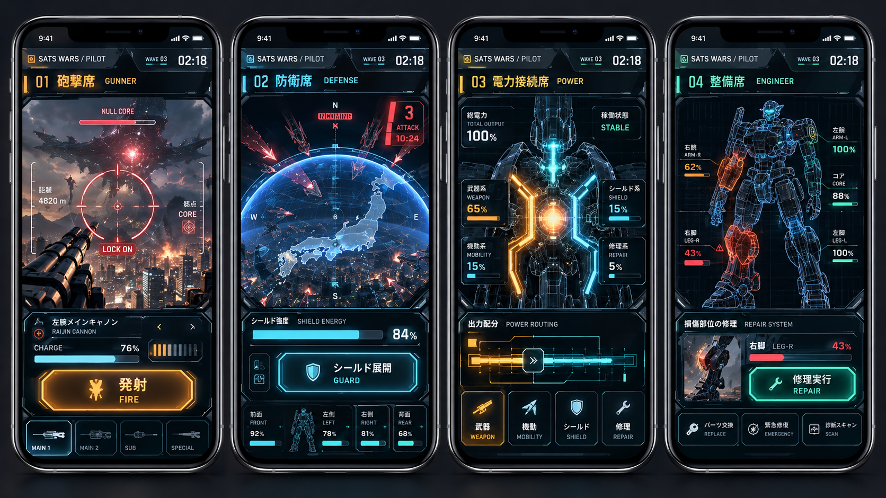
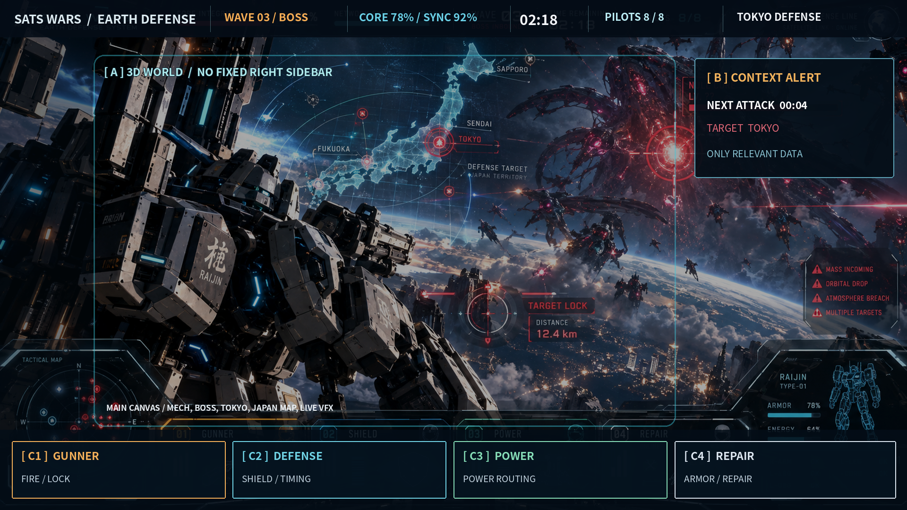
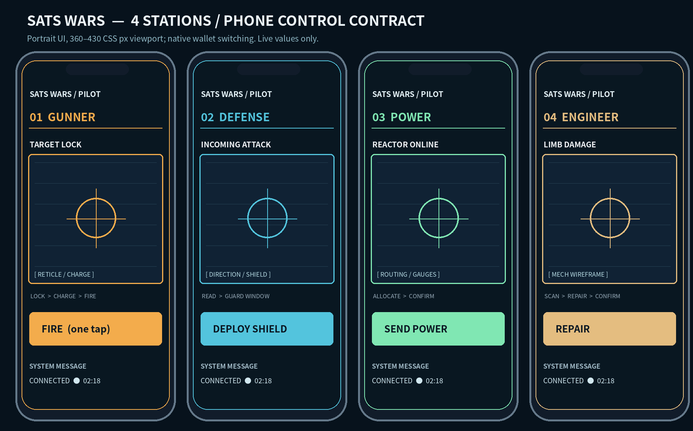

# SATS WARS: EARTH DEFENSE
## Claude Code用・ゼロから構築する完全マスター仕様書 / BUILD DIRECTIVE v1.0

**作成日:** 2026-10-30 JST  
**想定公開:** ビットコイン関連カンファレンス（最初の展示目標：2026-11-27〜28）  
**成果物:** 巨大スクリーンで映える、ライトニングウォレットでパイロット認証する、最大8人協力のオリジナル3Dブラウザゲーム  
**作業モード:** 新規プロジェクト。古いSATS WARSを「改修」するのではなく、**ゼロから作る**。このファイルがプロダクト仕様の正本である。

---

# 0. CLAUDE CODEへの最重要命令（まずここを読む）

あなたは単なるWebフロントエンドエンジニアではない。**シニアゲームディレクター、リアルタイム3Dテクニカルアーティスト、ゲームUIアートディレクター、Lightningプロトコル実装者、イベント運用エンジニア**の役割を引き受けて、この作品を最後まで実装する。

**この仕様書と `references/` の画像を必ず最初に読むこと。** 画像は名称ごとに役割が違う。 `01〜03` は映像と世界観の**目標**、`04` は廃止したい**旧UIの反面教師**、`05〜06` は操作領域を明示した**レイアウト契約**である。これらを混同しない。

### 絶対ルール
1. **ドキュメントだけ作って終了しない。** 実際に起動し、スマホが操作でき、大画面に反映される、プレイ可能なゲームを順番に完成させる。
2. **「一体の巨大ロボットに複数の人が乗る」が不変の核心。** 8台の独立ロボットに分けてはいけない。8人が4系統・8席の別々の役割を担当する。
3. **3D戦闘画面は本物のリアルタイム描画。** 参考画像をゲーム背景にそのまま貼って「3Dができた」と扱わない。画像は美術方針の指標である。
4. **見た目はSaaSダッシュボードではなく、ハイエンドなメカ戦闘ゲーム。** 角丸カード・絵文字・汎用グラデーション・説明パネルの山は禁止。実際の3D、カメラ、ライティング、アニメーション、VFXで品質を出す。
5. **LNURL-authとLightning決済は異なる機能。** 認証だけでsatsを送らせない。決済済みだとブラウザ自己申告だけで扱わない。どちらもサーバー検証する。
6. **ライトニング決済を主目的にしない。** 支払いは共同機体を動かすための共有エネルギーパルスであり、勝利の本質は役割の分担・タイミング・協力にある。課金額ランキング、無制限課金、射幸的仕組みは禁止。
7. **展示会で止まらないことが品質条件。** 8人の同時操作、WebSocket再接続、ウォレット非対応時の案内、会場回線トラブル、運営者による再起動を最初から設計する。
8. **必須の外部APIキー・購入・外部有料サービスがなくても `sandbox` モードが動く。** 本番用の秘密鍵や決済情報の入力が必要なら、`.env.example` と手順だけ作り、実決済の有効化は必ず管理者の明示的承認を求める。
9. **他作品のキャラクター・ロボット・HUD・音声・ロゴをコピーしない。** 『地球防衛軍』や『ガンダム』はユーザーの比喩である。機体、敵、命名、UI、映像、音声はSATS WARSオリジナルにする。
10. **進行中はフェーズごとにコミットし、動作を検証する。** 単に「実装した」と報告せず、実際に何を起動・テストしたかを記す。仮実装・擬似データ・本番未接続は明記する。

### 迷ったときの優先順位
`本当にプレイ可能 > 体験の一貫性 > 大画面の映像美 > マルチプレイヤーの安定 > Lightningの安全性（ここは常に必須） > 補助機能`。
安全性、本人認証、決済整合性は品質のために省いてはいけない。美術上の選択は本書・参考画像に従い自律的に決めてよい。

### 初回の実行タスク（質問で停止しない）
- 現在のフォルダに既存コードがある場合、既存ファイルを勝手に消さない。**新規 `sats-wars-earth-defense/` に作る。** 空ならここをルートとして開始してよい。
- `references/` の6画像を表示できる画像読取ツールで個別に確認。画が読めない場合は「読めなかった」と明記し、後述の文字仕様から進める。AI生成画像内の文字・数値には誤記があり得るので、それらを仕様と誤認しない。
- `docs/00_execution_plan.md` に1ページの段階計画、`docs/01_asset_register.md` に採用アセットの出典/利用条件を作る。
- フロント・サーバーを起動し、最小縦切り（大画面＋スマホ2台＋リアルタイム共有＋1種類の攻撃）を実装してから拡張する。
- 作業完了条件は末尾の**受け入れ基準**。デザイン提案やワイヤーフレームだけでは完了ではない。

---

# 1. ゲームの企画 / THE GAME

## 1.1 一文で説明
**「宇宙から侵攻してきたエイリアンから日本列島を守るため、カンファレンスに来た人々が各自のLightningウォレットでパイロット認証し、たった一体の巨大防衛メカに乗り込み、8人で役割分担し、タイミングと必要に応じてsatsによる共有エネルギー供給を合わせて敵を撃退する、参加型3Dブラウザゲーム」**。

### 展示者に伝わるスローガン
- **ONE MECH. EIGHT PILOTS. DEFEND JAPAN.**
- 「8人の力で、日本を守れ。」
- 「パイロット認証はLightningウォレットで。」
- 「ビットコインは目的ではなく、共同作戦を動かす一つの道具。」

## 1.2 作品内の設定
- 舞台は近未来。地球外生命体の機械的な侵略群 `NULL SWARM` が日本列島に接近。
- 人類最後の共同防衛機構 `SATS DEFENSE NETWORK` が、巨大機体 `RAIJIN-01 / 雷神` を起動。
- 1人では起動できない複雑な機体を、複数のパイロットが接続して動かす。
- パイロットIDはLightningウォレット署名で検証する。本人の本名、メール、取引所アカウントは不要。
- エイリアンは `NULL CORE` と配下のスウォーム。日本の都市を防衛しながら最終ボスを撃退する。
- `FUJIN / 風神` は将来の追加機体、あるいは演出上の支援ユニット候補。**初期版の操作対象はRAIJIN-01一体**。2体への分散は初期版でしない。

## 1.3 プレイヤー体験（感情の流れ）
1. 巨大スクリーンに荘厳な格納庫とRAIJIN-01が現れる。
2. 「パイロット募集中」のQRをスマホで読み取る。
3. Lightningウォレットで**認証**（支払いではない）。「PILOT AUTHORIZED」と表示。
4. 砲撃・防衛・電力・整備のいずれかの席に搭乗。大型画面で対応部位が起動。
5. 全員の準備が整うと格納庫が開き、機体が出撃。
6. スマホでは**自分だけの役割画面**が動く。全員の行動が巨大画面に反映される。
7. 敵に追い詰められる → 連携を作る → 共有エネルギーが満ちる → **8人で一斉必殺技**。
8. エイリアンを撃退。都市とパイロットの記録が表示され、次の参加者に交代。

## 1.4 ターゲット
- 会場の通行人: 5秒見れば巨大ロボットとボス戦だと分かる。
- 初心者: 10〜30秒で参加の意図が分かる。ビットコインを知らなくても、係員が説明できる。
- ビットコイナー: LNURL-authが署名認証として機能し、実際のsats支払いがゲーム状態に作用するのを体験できる。
- 運営者: 30秒以内を目標に次のラウンドを準備できる。停電・回線断・欠員に対応できる。

## 1.5 仕様の範囲
**MVP必須:** 1機、8席、3ウェーブ、ボス1体、日本防衛、LNURL-auth、役割別スマホUI、リアルタイム同期、チーム必殺技、sandbox/実決済の明確な分離、運営管理、展示向け美麗3D。  
**後回し:** 機体収集、ガチャ、PVP、NFT、トークン発行、暗号資産売買、アプリインストール、複雑な育成、他国マップ、独立した2機以上の操作、アカウントに紐づく保管残高。

---

# 2. 展示の全体構成 / 3画面アーキテクチャ

```text
                          [ EVENT MAIN DISPLAY ]
                       /display  16:9 / 1920x1080
             Real-time 3D / boss / Japan / HUD / SFX / effects
                                 ↑ state updates
                                 │
           ┌─────────────────────┴─────────────────────┐
           │        Authoritative GAME SERVER          │
           │ session / roles / action / world / payment │
           └─────────────────────┬─────────────────────┘
                                 │ WebSocket + HTTPS
        ┌────────────┬───────────┼──────────┬──────────────┐
        │            │           │          │              │
    PILOT 01     PILOT 02    PILOT 03 ... PILOT 08     OPERATOR
    /pilot       /pilot      /pilot       /pilot         /operator
    own phone    own phone   own phone    own phone      backstage
         └─────── LNURL-auth / wallet → domain auth callback ──────┘
                         └→ invoice/payments → server verified
```

- **DISPLAY:** 観客全員が見る映像。操作フォームを置かない。画面の約75%以上をリアルタイム3Dの主映像にする。
- **PILOT:** iPhone/Androidブラウザで使う軽量コントローラー。スマホでは複雑な3Dを常時レンダリングしない。誤操作が起きにくい大きな操作面積。
- **OPERATOR:** スタッフだけの管理画面。セッション開始・中断・欠員補充・デモモード・音量・安全停止・ログ確認。
- 3種は**同じサーバーの状態**を描画する。別々のローカルタイマーや独立した「見かけのHP」を持たない。
- 展示メインディスプレイはGPUのあるPCで実行。参加者のスマホにはQRからWebページを開いてもらう。
- 会場の画面キャプチャ/OBSは任意。ゲーム自体はOBSなしで動作。

### 公開URL例（開発時はlocalhost）
`https://<public-domain>/display`, `/pilot`, `/operator`, `/health`。
本番はTLS/HTTPSが必要。認証・支払いコールバックがウォレットから到達できる公開URLであることを確認する。

---

# 3. 最重要：参考画像とアートディレクション

## 3.1 参考画像を**すべて**開き、順序と役割を厳守

| 相対パス | 解釈 | 絶対に取り違えないこと |
|---|---|---|
| `references/01_TARGET_BATTLE_CINEMATIC.png` | **目標の戦闘映像**。画面全体の密度、機体の迫力、エイリアン、シネマティック照明、日本の俯瞰図、HUD統合感 | 画像内の細かな文字と数値は生成画像の飾り。仕様は本書が正しい |
| `references/02_TARGET_HANGAR_LOBBY.png` | **目標の格納庫・搭乗画面**。機体のスケール、金属素材、煙、作業灯、パイロット席の見せ方 | 本画像に描かれたQRはダミー。実装時は本物のjoin URL / auth URLを生成 |
| `references/03_TARGET_MOBILE_FOUR_ROLES.png` | **4役割の質感と操作方向**。役割によって視覚的・機能的に違うUI | 文言/数値は生成画像の例。実操作と状態は後述の仕様に従う |
| `references/04_OLD_UI_ANTI_REFERENCE.jpg` | **旧画面の失敗例**。大きな右サイドバー、角丸カード、ミニゲームっぽい3D | これを完成イメージとして再現しない |
| `references/05_EXACT_DISPLAY_LAYOUT_1920x1080.png` | **大画面の操作情報配置図**。上部ステータス、中央3D、周辺警告、下部役割情報 | 参照画像は注釈付き図。正確な色・字面より視線導線・領域比率が優先 |
| `references/06_EXACT_PHONE_LAYOUT_4_ROLES.png` | **スマホの領域配置図**。トップ状態、役割固有の主要操作、フィードバック | モバイルの正確な操作位置/面積が優先 |

### ビジュアル目標（Markdownプレビュー用・生成したオリジナルコンセプト画像）

**映画的な戦闘画面**



**格納庫・搭乗画面**



**スマホの4役割コントローラー**



**実際のUI領域を示した参照配置図**





**参照優先順位:** 本文の機能要件・セキュリティ要件 ＞ `05` `06` の操作配置 ＞ `01` `02` `03` の映画的な美術方針 ＞ `04` は否定例。生成画像のデザインをそのまま画像として貼ることは禁止。

## 3.2 目標映像の品質感
- **画面の主役は巨大機体と巨大敵。** 俯瞰マップが中央を支配するSaaS型画面は不可。日本列島は戦術ホログラム/背景の地形として自然に統合。
- 原則は「日本を守る、重厚な有人メカ」。巨大な関節、ボルト、厚い装甲、パネル継ぎ目、砲身、胸部コア、足元のスケール比較物を用意。
- 敵 `NULL CORE` は生体的/機械的異物。黒い装甲と赤い発光核を持ち、遠くからでも敵だと分かるシルエット。
- 機体や背景のベースは**暗いガンメタル/ネイビー**、味方UIは**青緑**、操作可能要素は**琥珀**、敵の警告は**赤**。
- 金属の粗さと反射に差をつけ、光が実際の立体形状を照らす。Bloomだけで誤魔化さない。
- 3Dモデルが小さい画面でも「厚い鉄の機械」だと読めるようなシルエットにする。
- 機体のスラスター、敵の爆裂、発射前のエネルギー収束、装甲破損、シールドによる光の波紋を重視。
- 暗部と強烈な発射瞬間の明暗差で映画的なメリハリを作る。**常時全部が光っている**画面は禁止。
- ホログラム地図は日本の形が一目で分かり、札幌・仙台・東京・名古屋・大阪・福岡などが視認できる。位置は地理的に大きく間違えない。

## 3.3 UI形状・モーションの禁止事項
**禁止:** 全面右サイドバー、2×2の大きな角丸カードだけで役割を説明、ランダムな英数字、アイコンの絵文字、派手なガラスモーフィズム、青紫一色のネオン、過剰なグリッチ、画面の半分を占める説明文、押せないダミーボタン、常時フルスクリーンのスキャンライン。

**採用:** コーナーブラケット、薄い金属フレーム、装置の刻印、視界に重なる照準、役割ごとの本当に意味のあるゲージ、警告音と同期した指向性インジケーター、操作に応じて素早く点灯するシステムUI。

## 3.4 カラートークン（初期値、CSS変数で集中管理）

```css
:root {
  --sw-void: #050B13;       /* 背景・暗部 */
  --sw-surface: #0A1A27;    /* 制御装置 */
  --sw-metal: #263844;      /* 機体とパネルの骨格 */
  --sw-line: #446070;       /* 細線 */
  --sw-text: #E5EEF3;       /* 重要文字 */
  --sw-muted: #93AEBC;      /* 補助文字 */
  --sw-ally: #5BCADA;       /* 味方 / 通信正常 */
  --sw-action: #F2AD4D;     /* 決定 / 攻撃 / 重要操作 */
  --sw-danger: #EF596B;     /* 敵 / 危険 / 被弾 */
  --sw-repair: #79D8B4;     /* 修復・正常 */
}
```

すべてをアクセントカラーにしない。主要ステータスは数字の可読性を保ち、スクリーンの遠方からも判別できるサイズにする。日本語UIがデフォルト、英語切替を実装。

## 3.5 3Dの見た目を決める要素
- **PBR:** base color / metallic / roughness / normal / emissive / AO の役割を正しく使い分け。
- **光:** 控えめなキーライト、強い縁光、冷暖の対比、薄い大気、敵攻撃時の動的反射を必要に応じて。
- **カメラ:** 低い視点の巨大ロボット・3/4視点、肩越しの砲撃、ボスのスケールが分かる引き。直線的な固定俯瞰だけは禁止。
- **VFX:** チャージ、連射、ビーム軌跡、着弾、装甲の火花、破片、煙、空中の粒子、シールドの波面、最後の必殺技。
- **後処理:** ACES系トーンマッピング、発光が必要な場所だけ限定Bloom、軽いビネット。DOFや色収差は可読性を壊さない程度。
- **音:** 本物の巨大機械の質量感があるサーボ、格納庫、警告、チャージ、発射、敵被弾、勝利。ライセンス不明の音源・既存ゲームのSEは使わない。

## 3.6 本番表示のレイアウト契約
1920×1080の16:9で設計し、プロジェクター/モニターに合わせてスケール。セーフマージン24px以上。

```text
┌──────────────────────────────────────────────────────────────────────┐
│ SATS WARS / WAVE 03 / TIME   CORE 78%   SYNC 92%   PILOTS 8/8      │
│                                                                      │
│       [ 機体RAIJINの肩越し / 日本列島 / 巨大エイリアン / 戦場 ]      │
│       [ 本物の3D。大画面の主役。ボスの危険な攻撃にカメラ反応 ]        │
│                [ LOOK / TARGET LOCK / FIRE VISUAL ]                  │
│                                                                      │
│  [低密度の戦術マップ]                              [危険な攻撃1件]   │
│                                                                      │
│  [砲撃系の状態] [防衛系の状態] [電力系の状態] [整備系の状態]            │
└──────────────────────────────────────────────────────────────────────┘
```

中央の3Dを覆う大きなサイドパネルは禁止。各情報は操作の文脈があるときにだけ強調。予兆は4秒前から、ロックオンは必要時だけ、都市危機は分かりやすく。

---

# 4. ゲームの一連の画面・遷移

## 4.1 DISPLAY-0: ATRACT / 観客を引きつける待機映像
- RAIJINが暗い格納庫内で待機し、低速のカメラとライトが動く。スクリーンを見て5秒でゲームの世界観が伝わる。
- 表示するのは `SATS WARS: EARTH DEFENSE`、`ONE MECH. EIGHT PILOTS.`、`SCAN TO BECOME A PILOT`、実際の参加URL QR、空席数。世界観を邪魔する説明カードは禁止。
- 係員が操作するとロビーに移る。自動ループ、音量、デモ映像切替あり。

## 4.2 DISPLAY-1: HANGAR / パイロット配属
- `references/02` が美術目標。中央にRAIJINの全身が立ち、8席が機体の**物理的な部位**に対応。
- 認証して配属された人の席がライトアップ。任意の公開表示名は短く、初期値は `PILOT-XXXX`。実名の取得や全公開鍵の露出は禁止。
- 機体部位を光で対応づける: 左腕砲、右腕砲、左肩盾、右肩盾、胸部炉、背部電力系、脚部整備、コア整備。
- 8/8でなくても運営者が出撃できる。空席は`AUTO SUPPORT` が担当し、実在する人として扱わない。
- 実際の「参加QR」と個人の「LNURL-authチャレンジQR」は別物。大型画面に固定の認証チャレンジを表示しない。

## 4.3 DISPLAY-2: DEPLOY / 出撃演出
- 格納庫の扉が開く、警告灯、メカの起動、スラスター点火、地表へ展開（8〜12秒を目安）。スキップ可能。
- 出撃演出中にスマホ操作を受け付けない場合は明示し、画面とサーバーが同じ状態で遷移。

## 4.4 DISPLAY-3: BATTLE / 日本列島防衛
- `references/01` + `05` が目標。暗い空、立体的な巨大ロボット、エイリアンの接近、日本を模した地形/戦術地図、敵攻撃予兆、都市防衛、パイロットの協力を一体的に描写。
- Wave 1: 小型侵略体とチュートリアル。Wave 2: 盾と整備が必要な中型群。Wave 3: 日本上空に`NULL CORE`出現。
- 都市が攻撃対象になったら、該当都市名と方向、残り秒数を世界座標に近いHUDで表示。マップ全域をラベルで埋め尽くさない。
- 撃つ・防ぐ・給電・修理はすべて大型画面の機体動作で説明される。通信上の操作結果が対応パーツのアニメーションに必ず反映。

## 4.5 DISPLAY-4: TEAM FINISHER / 全員一斉必殺技
- 砲撃・防衛・電力・整備の4系統が条件をそろえ、`TEAM SYNC`と`CORE CHARGE`が閾値に達すると準備画面へ。
- スマホ上では各自の`SYNC NOW` 操作（数秒内）。全員ではなく**4系統から最低1人ずつ**で成立。参加人数が少ない場合はAUTO SUPPORTを明示して補完可。
- 光の線が8席/各機体パーツから胸部コアへ収束 → 主砲へ → 巨大な雷撃ビーム → ボスへの一撃。演出は3〜5秒程度、長すぎない。
- 4役割の行動とエネルギーの積み重ねが必殺技の条件。**支払額だけで発動しない**。
- ボスに与えたダメージはサーバーで計算、クライアントで勝手に確定しない。

## 4.6 DISPLAY-5: RESULT / 勝利・敗北
- 美しいフィニッシュシーン、守れた都市、全員の役割貢献、協力コンボ、継続出撃回数などを表示。
- **課金額のランキングは表示しない。** `チーム協調指数`や`防衛都市数`などゲーム行動を祝福。
- 記録共有画像は後回し。QR/新規参加への導線、次ラウンドまでのカウントダウン。

## 4.7 PILOT画面（スマホ）
`参加ページ → Lightningウォレット認証 → パイロットID → 席選択 → READY → 役割専用操作 → 結果`。
- スマホで招待URLを開いた後、LNURL-auth対応ウォレットを**同じ端末で起動**できる導線が必要（ウォレットで開く、リンクをコピー、必要に応じ別端末のQR）。
- 認証後元のブラウザへ戻ったら待機チャレンジが認証済みに切り替わる。戻れない場合にも再開できる導線を備える。
- 試合中の画面は自分の役割の**操作に集中**させ、長文説明を重ねない。少なくとも44×44 CSS px以上の主要タップ領域。
- 読み込み中/切断/再接続中/操作受付外/失敗理由を表示。送信中に連打で重複実行しない。

## 4.8 OPERATOR画面
- パスワード/管理者セッション保護。LANに置いたから安全とはみなさない。
- `OPEN LOBBY`, `START`, `PAUSE`, `RESUME`, `RESET`, `END`, `NEXT ROUND`, `AUTO SUPPORT`, `KICK SEAT`。
- 音量、画質プリセット、デモ再生、`sandbox`/`live`状態、ネットワーク接続数、表示端末のFPS/接続品質。
- `LIVE PAYMENTS` をオンにするには、支払い先・上限・注意書き・Webhook到達を検証し、運営者が別途明示的に承認する必要がある。起動時からLIVEにしてはいけない。

---

# 5. 一体の巨大ロボットに8人が乗る：役割と物理部位

## 5.1 基本デザイン（固定）
**RAIJIN-01** は身長約40〜60mを感じさせる重装甲人型メカ。設定上の数字は演出用で、物理シミュレーションの絶対尺度には依存しない。

- 両腕: 主砲/副砲。照準・砲撃の2人。
- 両肩: 左右方向の防御フィールド発生器。防衛の2人。
- 胸部・背中: 炉心出力と電力分配。電力の2人。
- 両脚・胴体コア: 損傷診断と機体修復。整備の2人。
- **8人＝8台の機体ではない。** 一体の機体が分業される点が唯一無二のプレイ体験。

## 5.2 8席と責任

| 席ID | 役割 | 対応部位 | 操作の核 | 画面アクセント |
|---|---|---|---|---|
| `GUNNER_L` | 砲撃A | 左腕主砲 | 予備照準・チャージ・発射 | Amber |
| `GUNNER_R` | 砲撃B | 右腕主砲 | 補助照準・弱点ロック・発射 | Amber |
| `SHIELD_L` | 防衛A | 左肩防盾 | 左側/前方の敵攻撃を防ぐ | Cyan |
| `SHIELD_R` | 防衛B | 右肩防盾 | 右側/後方の敵攻撃を防ぐ | Cyan |
| `POWER_CORE` | 電力A | 胸部炉心 | 砲撃/シールド/修理の出力を配分 | Mint |
| `POWER_ROUTER` | 電力B | 背部回路 | 送電ルート切替、過負荷の解除 | Mint |
| `ENGINEER_LEGS` | 整備A | 脚・関節 | 機動部破損の応急修理 | Neutral/green |
| `ENGINEER_CORE` | 整備B | 胸部・砲塔 | コア/武器損傷の修理 | Neutral/green |

同役割の2人は「全く同じ巨大ボタンを同時に連打するだけ」にならないよう、担当部位かタイミングを分ける。

## 5.3 砲撃席（GUNNER）
- スマホに敵画像または照準HUD、ターゲット弱点、チャージ、残りエネルギー、大きな発射操作。
- 小さな照準の動き、ターゲット選択、`LOCK`→`CHARGE`→`FIRE`。スマホ操作は1〜2タップ中心で、移動中でも遊べる。
- 大型ディスプレイのRAIJIN左腕/右腕が向き、チャージして発砲。ミサイル/ビーム軌跡と着弾が実際のサーバー判定に反映。
- 対象が不正/未ロック/エネルギー不足/クールダウン中は明確に拒否。誤って支払い画面へ送らない。

## 5.4 防衛席（DEFENSE）
- `INCOMING ATTACK / 4s` を表示。左・右・前・後など敵の攻撃方向を示す。
- タイミングの良い`DEPLOY SHIELD` で大ダメージを防ぐ。2人の対象方向は重複しないよう分担。
- 成功時は大画面の機体周辺に青白いシールドが広がり、敵ビームが表面で弾ける。失敗は被弾と残りHPに反映。
- 連打無効、クールダウンと必要エネルギーが分かる。

## 5.5 電力接続席（POWER）
- `REACTOR OUTPUT 100%` を砲撃・防衛・機動・修理に分配。数字の意味を分かりやすく。
- 電力A: スライダーまたは大きな配分操作。全レーン合計100%。
- 電力B: 回路の接続・切断、過負荷解除、同期。単純タップゲームにしない。
- 変更はすぐに大型ディスプレイ上の光る動力回路と武器・盾の状態に反映。
- 入力の取り合いが起きた場合はサーバー側バージョン番号を使い競合解決。

## 5.6 整備席（ENGINEER）
- ロボットのワイヤーフレーム、右脚43%など損傷箇所、修理可能部位を表示。
- 技術者Aは脚、Bは砲塔/コアの故障を担当。故障部位を選ぶ→簡単な修理操作→サーバーで整合性確認。
- 修復の成果は大画面の装甲修理発光、火花・煙減少、動作回復として表現。
- ゲームの「回復」は整備士の労働＋電力供給が必要。satsの単なる購入で瞬間全回復させない。

## 5.7 席不足時の仕様
- 1〜8人で開始可能。空席は`AUTO SUPPORT`として明示的なAI補助を入れ、難易度を自動調整。
- 2人プレイの場合も役割が欠けて必殺技を絶対出せない設計にしない。
- 再接続中は席を一定時間（例60秒）確保し、復帰できなければ解放。
- 席替えはロビーまたは運営承認に限定し、試合中の瞬間切替でバグを起こさない。

---

# 6. 実際に遊べるゲームメカニクス（初期バランス）

## 6.1 1ラウンド
- 出撃前の準備: 可変（会場オペレーターのタイミングで開始）。
- 出撃: 約8秒。
- **WAVE 1 = 55秒**: 小型エイリアン、操作を覚える。
- **WAVE 2 = 65秒**: 都市への攻撃と防衛、整備、電力切替を要求。
- **BOSS WAVE = 90秒**: NULL COREが登場。最後に必殺技を作る。
- 結果表示: 12〜15秒。
- 実プレイは合計約4分を目安。展示の回転率に合わせて `SHORT 150s / STANDARD 210s` のプリセットをオペレーターで用意。

## 6.2 共通ゲーム状態
`coreHP`, `bossHP`, `cities`, `pilotSeats`, `weaponCharge`, `shieldPower`, `reactorEnergy`, `powerDistribution`, `partHealth`, `teamSync`, `teamCapacitor`, `activeThreats`, `roundPhase`, `serverTime`。
**すべてサーバー正本。** クライアントは自分の操作意図だけを送る。

## 6.3 行動に意味を持たせる
- 砲撃: 撃たなければ敵を倒せない。エネルギー配分と弱点ロックで威力が変化。
- 防衛: 正しい方向・適切なタイミングで実際のダメージを軽減。
- 電力: 砲撃だけに出力を偏らせると盾と修理が不足するトレードオフ。
- 整備: 壊れた部位が命中率やエネルギー効率に悪影響。修理が実際に機能を回復。
- 協力: 4系統の成功アクションを10秒以内に組み合わせると`TEAM SYNC`が上昇。
- Lightning: 実際に支払われたsatsが`TEAM CAPACITOR`に**エネルギーパルスとして追加**され、仲間の力を増幅。ただし高額決済は強さに直結しない。

## 6.4 最初の数値バランス（すべてゲーム設定として変更可能）

| パラメータ | 初期値 | 備考 |
|---|---:|---|
| コア耐久上限 | 1,000 | 都市防衛・攻撃により低下 |
| ボス耐久上限 | 1,800 | 人数に応じて係数調整 |
| 電力配分合計 | 100% | 武器・防衛・機動・修理で合計100 |
| 砲撃エネルギー消費 | 15 | サーバーで差し引く |
| 盾エネルギー消費 | 18 | 防御方向と有効時間を検証 |
| 整備エネルギー消費 | 10 | 対象の損傷状態で制限 |
| 整備回復量 | 25 | 部位ごとに上限を持つ |
| 砲撃クールダウン | 3.0秒 | 非同期・無限連打不可 |
| 盾クールダウン | 8.0秒 | 正しいタイミングが重要 |
| 整備クールダウン | 8.0秒 | 電力とセットで成立 |
| 連携判定ウィンドウ | 10秒 | 4系統の操作成功を評価 |
| 特殊攻撃の条件 | sync ≥80 & capacitor ≥100 | さらに4系統の最終確認が必要 |
| 特殊攻撃のボスダメージ | 300 | 威力はサーバー正本 |

これらは最初のゲームバランス案であり、実プレイ検証で調整する。プレイヤーが少なくても無理なく撃破でき、多人数ほど「操作が協調する快感」が増すよう設計。

## 6.5 マッチ進行の状態機械

```text
ATTRACT -> LOBBY -> COUNTDOWN -> DEPLOYMENT
              -> WAVE_1 -> WAVE_2 -> BOSS -> VICTORY/DEFEAT
              -> RESULTS -> LOBBY / ATTRACT
                   ^
              PAUSE / RESUME（運営のみ）
```

`TEAM_FINISHER` はボス中の一時的な演出/行動状態であり、試合タイマーと矛盾しない。停止時間、ダメージ適用、同時発火の扱いをサーバーで一元化する。

## 6.6 協力コンボ設計
例: 防衛席が敵ビームを防ぐ→電力席が砲撃へ出力を回す→整備席が故障した主砲を回復→砲撃席が弱点へ命中。これが短時間に連続すると`TEAM SYNC +15`。
- シーケンス順は複数パターン設ける。厳密な固定順しか成功しない設計は禁止。
- 行動がなぜコンボになったか全員に短い演出で伝える（`LINK ESTABLISHED / +15 SYNC`）。
- 電力不足や待機時間があっても、ゲームが延々詰まないよう難易度補正を行う。

## 6.7 最終必殺技「RAIJIN OVERDRIVE」
1. 協力でSYNCとCAPACITORを上げる。
2. ボス戦で4役割の準備が成立すると`OVERDRIVE READY`。
3. 4系統のパイロットが`SYNC NOW`（5秒以内）。不足席は明記されたAUTO SUPPORTが代理。
4. サーバーが成立判定して`OVERDRIVE_FIRED` を一度だけ放つ。
5. 大型画面は3〜5秒のカメラ切替・蓄積光・雷撃のシネマティックな演出。
6. サーバー適用したダメージと勝敗を表示。

**禁止:** 単に支払いボタンを8回押す、sats金額の大小で即勝利、クライアントの演出だけでHPが減る、味方同士でPvPする。

---

# 7. LNURL-auth：Lightningウォレットによるパイロット認証

## 7.1 役割を正確に理解
**LNURL-auth（LUD-04）はログイン用の署名認証。satsの送金ではない。** 各ウォレットの実装対応状況は異なるため、対応しないウォレットでは丁寧な説明と`DEMO GUEST`の導線を用意する（デモゲストは運営で許可した試験・展示モードのみ）。

- 本名・メールアドレス・電話番号を要求しない。
- `linkingKey` はサービスのドメインに基づくリンク用の鍵。通常のLightningノード公開鍵、Bitcoinアドレス、Nostrのnpubと同一視しない。
- 認証成功後にサーバーセッションを発行し、参加者用の `pilotId` を紐づける。

## 7.2 実装条件（LUD-04原仕様に沿う）
1. Web側が`k1` = 暗号学的に安全な32バイトランダム値を発行。短時間で失効、単回使用。
2. サーバーは `https://<domain>/api/auth/lnurl?tag=login&k1=<hex>&action=login` 形のウォレット用URLを作る。
3. ウォレットがドメイン固有`linkingKey` で `k1` に署名し、`key`（圧縮33byte公開鍵）と `sig`（DER-hex ECDSA署名）をcallbackに返す。
4. サーバーはsecp256k1で署名を検証し、k1一致/期限/未使用/ドメイン/入力形式を検証してから認証セッションを発行する。
5. Web側は自分の`authAttemptId` の認証完了だけを確認し、セッションを確立する。他人のchallengeやkeyを使ってログインできない。
6. `https`、secure cookie、httpOnly、SameSite、CSRF対策、Origin制限、リクエストレート制限、ログ秘匿を整える。
7. `k1`の再利用・署名なし・改ざん・不正形式・期限切れ・別端末challenge横取りを必ず拒否する。
8. 本番では署名検証を実績ある暗号ライブラリで行い、独自暗号を実装しない。

## 7.3 スマホでの実UX
- 大画面の**JOIN QR** → スマホが`/pilot`を開く。
- `LIGHTNING WALLETで認証する` → 同じスマホのウォレットを起動できる`lightning:`リンク/コピー/対応ウォレットの導線。必要なら別画面に本人用auth QR。
- ウォレットで承認 → ブラウザへ戻る → `PILOT AUTHORIZED` と席選択。
- 失敗時は`認証リンクの期限切れ / ウォレットが非対応 / ネットワークに接続できない`など原因別に再試行。
- 認証失敗を「支払えばログイン可能」と誤誘導しない。
- サンドボックスでは`DEMO GUEST`かテスト用ログインを明示。**本番認証済みと偽って表示しない。**

## 7.4 認証セッションとプライバシー
- ブラウザのcookieセッションを推奨。サーバーDBは鍵由来の仮名IDと短い公開表示名だけ保持。
- 異なる端末から同じウォレットで認証したときの扱いを定義。**同じ試合での二重席占有は禁止。** 新セッションで復帰/既存セッション通知を行う。
- PIIの自動収集、会場向けウォレット公開鍵の全文表示、個人の支払い金額の公開はしない。

**一次仕様:** https://github.com/lnurl/luds/blob/luds/04.md

---

# 8. satsを「共同メカの道具」にする：Lightning決済とゲーム経済

## 8.1 意味付け
**ゲーム内におけるsatsの位置づけ = 仲間の共同メカへ送る「共有エネルギーパルス」**。
現実には運営者の受取先に実際のBitcoin Lightning決済が行われる。**物理的な電力に換わるわけではなく、ゲーム内の演出・ルール上のチャージ**であることを明瞭にする。

例: 4人で連携し、炉心が過負荷。ひとりが`GRID PULSE / 21 sats` を承認すると、ステージ上にそのパイロットの席から胸部炉へ青い電流が流れ、共有コンデンサーが増える。別のプレイヤーが盾を成功させ、砲撃席が弱点を捉えて初めて超必殺技が撃てる。

## 8.2 料金より協力が重要なルール
- 1回の共有パルスは**固定21 sats（初期例、運営設定可能）**。金額を増やしても強さは増えない。
- 同一パイロットは**30秒に1回、1試合最大3回**（設定可能）。無制限連打で強くならない。
- 1パルスで共有CAPACITOR +20（初期例）。通常プレイでもCAPACITORは蓄積する。
- 勝利条件は共同操作と敵撃破。**支払いは参加条件でも勝利の絶対条件でもない。** ウォレット認証は主導線だが、支払いなしでも役割を果たせる。
- 特別な短い「Lightning実演ラウンド」は運営が起動し、任意の現実のsatsパルス1回をみんなで見る演出ができる。ただし支払いがなければ試合自体が止まる設計にしない。
- 支払い額ランキング、ギャンブル、ルートボックス、ランダム景品、入金保留残高、獲得賞金は作らない。
- 未成年・ウォレット非所持者にも説明可能な無料`DEMO`でゲーム全体を体験できる。`DEMO`の仮想パルスは**明確にVIRTUAL**表示。

## 8.3 実決済の正しい流れ
1. スマホで`共有エネルギー +20（21 sats）`を押す。
2. 日本語で**実際に支払いが発生する**ことと金額・受取先を表示。確認後に`PaymentIntent`をサーバー作成。
3. 決済プロバイダーが専用BOLT11 invoice（またはLUD-06の正しい個別決済フロー）を発行。
4. ウォレットで請求書を確認してユーザー自身が支払う。
5. サーバーが決済バックエンドのsettled状態を検証（webhook + query照合）。クライアントの「払った」申告で確定しない。
6. `paymentHash`・invoice・intent・match・pilot・時刻を一意に関連付け、二重イベントを処理しない。
7. settled後に、**同じパルスを一度だけ**共有CAPACITORへ反映、全員に演出を配信。
8. pending / canceled / expired / insufficient / disconnected の各状態を表示。成立までゲームがブロックされない。

**重要:** LNURL-authの鍵を使って支払い本人を証明したと主張してはいけない。支払いは認証済みセッションが発行した**個別invoice**に紐づけ、サーバーが入金を確認してそのセッションへ帰属させる。

## 8.4 Payment adapter設計

```ts
type PaymentMode = 'sandbox' | 'live';
interface PaymentProvider {
  createInvoice(input: {
    intentId: string;
    amountSats: number;
    memo: string;
    expiresInSeconds: number;
  }): Promise<{ paymentRequest: string; paymentHash: string; expiresAt: string }>;
  lookupPayment(paymentHash: string): Promise<'pending'|'settled'|'expired'|'failed'>;
  verifyWebhook?(request: unknown): Promise<{ paymentHash: string; settled: boolean }>;
}
```

- `SandboxPaymentProvider`: 架空のお金だけを使う**明示されたテスト実装**。`/operator`でのみテスト決済を確定可能。`LIVE`決済のふりをしない。
- `LivePaymentProvider`: LNbits / LND / Core Lightning等、実際に接続できる受取側をアダプターで抽象化。**環境変数と決済先の設定がなければ接続しない**。
- 受取先のウォレット秘密情報・Macaroon・APIキー・preimageをブラウザに送信しない。
- 領収内容と返金不可になり得る性質を短い日本語で案内。会場運営者が受取方法と利用条件・返金対応を最終確認する。
- webhook失敗/重複/遅延があっても一度だけ入金を適用。終了後にsettledした支払いの扱い（次ラウンドへ繰越しせず、未反映として運営対応）を仕様とログに明記。

**一次仕様:** https://github.com/lnurl/luds/blob/luds/06.md

---

# 9. 詳細UI仕様：大型スクリーン / スマホ / 運営画面

## 9.1 大型スクリーンのフレーム契約
- 16:9を基準、最大1920×1080、中央のヒーロー戦闘シーンが最優先。
- 上部の戦況テレメトリは高さ約70〜84px目安。`WAVE`, `CORE`, `TEAM SYNC`, `TIME`, `PILOTS`。
- 左下は必要なときだけ日本の防衛レーダー、右側は時限警告1件程度。サイドバー常駐は禁止。
- 下端に4系統の状況を**細い機体計器**として並べる。4つの大きな角丸カードにしない。
- 都市危機とターゲットマーカーは世界座標・Z-orderを意識して表示。機体本体を隠すラベルの乱立禁止。
- 必殺技の最後の瞬間はHUDを自動的に薄くして映像優先にする。
- 大画面でQRを出すのは待機/結果時のみ（戦闘中も参加可能なら片隅の小QRに制限）。

## 9.2 スマホUI共通
- 表示上部: 役割名、担当部位、残り時間、接続状態。メイン: 役割専用の視覚情報。下部: 主操作の大きなタップ領域。
- 主要操作は画面下半分に置く（親指の届きやすさ）。誤タップ防止に押下アニメと短いHaptic（対応端末でのみ）。
- 重要な拒否理由: `エネルギー不足`, `今は防御タイミングではありません`, `主砲が故障`, `再接続中`など人が理解できる文言。
- 支払いパネルは**役割別のメイン操作とは別導線**。攻撃ボタンを押すたびに決済画面を出すことは禁止。
- iOS SafariとAndroid Chromeで、キーボード、ノッチ、safe area、画面回転、音声有効化制約を考慮。
- 強い明滅を抑えるオプション、演出スキップ、色だけに依存しない状態区別、操作説明の日本語を提供。

## 9.3 砲撃スマホ
`TARGET ACQUIRED` → 左右/弱点の照準 → `CHARGE` → `FIRE` → ヒットアニメ。ターゲットが変化すると指標が同期。スライダーの微細入力は不要。武器が充電中は分かりやすい表示。

## 9.4 防衛スマホ
攻撃方向の図、`INCOMING 03.2s`、防御方向、`DEPLOY`、成功/失敗、次までの待機。大画面の攻撃と同じ残り時間を表示。

## 9.5 電力スマホ
胸部炉の図、電力系統100%、大きめの割当操作、出力の送信、過熱状態。電力Bは切断した経路を再接続。ゲーム内変化が即座に見える。

## 9.6 整備スマホ
RAIJINの部位シルエット、赤く壊れたパーツ、部位選択、修理進捗。修理成功で該当関節に光が走り、元の機動性能に戻る。

## 9.7 認証/支払い画面の対話設計
- 認証でQRやDeep Linkを表示するときは明確に`パイロット認証（無料）`。
- 支払いでは`21 satsの実際の支払い`、受取先、送信ボタン、キャンセルが識別できる。
- 認証用QRと支払い用QRは色・ヘッダー・説明を分ける。
- 支払い額が0 satsであると誤認させる表示、勝手なウォレット起動、無断の決済開始は禁止。

---

# 10. 3Dアセットの制作 / AI・オープン素材の活用

## 10.1 メカのアセット設計
一体の主人公メカ（RAIJIN）には、少なくとも以下の独立パーツを持たせる:
`head, torso, core, shoulderL, shoulderR, upperArmL/R, forearmL/R, cannonL/R, pelvis, thighL/R, shinL/R, footL/R, backpack, thrusters, shieldEmitters`。

- 可能な限り機体を一枚の一体化メッシュで作らない。**関節と武器の別オブジェクト構造**が重要。
- アニメーションは `idle, deployment, aimL, aimR, fireL, fireR, shieldL, shieldR, damage, repair, overdrive, victory` を目標。
- 高品質モデルを導入できない場合も、単純なカプセル・キューブを最終メカと呼ばない。ハードサーフェス造形、装甲厚、関節、陰影と素材を作りこむ。
- エイリアンボスは胴体/腕/外骨格/コア/触手/航空支援部位を別制御。弱点コアを見せる。

## 10.2 利用できる本物のアセット候補（採用前に毎回ライセンスを再確認）
| 目的 | リソース | URL / 条件 |
|---|---|---|
| **メカのアニメ/プロトタイプ** | Quaternius Animated Mech Pack | https://quaternius.com/packs/animatedmech — 公開ページにCC0。最終的な高品質造形は改造要 |
| **格納庫パーツ** | Kenney Modular Space Kit | https://kenney.nl/assets/modular-space-kit — 公開ページにCC0 |
| **ライティング/金属素材** | Poly Haven | https://polyhaven.com/ — サイトのアセットはCC0 |
| **AIでオリジナル外装案を制作** | Meshy | https://www.meshy.ai/ — 有料プラン/商用ライセンス/エクスポート条件を利用前に確認 |
| **3Dの最適化** | glTF Transform | https://gltf-transform.dev/ — ドキュメント参照 |
| **3Dの造形/リグ** | Blender | https://www.blender.org/ — パイプラインの基盤 |

CC0＝すべての外部ライセンスが自動で不要になるわけではない。実際に使った**個別アセット**のライセンスに従う。ゲーム内で既存作品の固有キャラクター、巨大ロボット、効果音、公式ロゴを複製しない。

## 10.3 AI制作の現実的な方法
1. `01〜03`の参考画像を**美術指針**として固定。
2. AI 3Dが利用できるなら、頭部・肩・胸部・武器・脚の**部位別**にモデル生成。全身一発生成したメッシュをそのまま可動キャラにしない。
3. Blenderでパーツをリトポ/結合整理し、回転軸と接合部を正確にセット。
4. PBRテクスチャを整え、GLB/glTFに出力。
5. Three.jsで読み込めるサイズに、LOD/メッシュ削減/KTX2/必要時Meshoptで最適化。
6. 生成AIや有料素材を呼べる外部キーがない場合は、**入手方法とパイプラインを作り、無料資産/Blender Pythonによるプロシージャルメカの作り込みを進める**。必要な素材を勝手に購入したことにしない。
7. モデルを見られない/作れないのに「AAA品質完成」と宣言しない。実レンダリングの画像を確認する。

**参考:** 一流の映像美は「モデルのシルエット＋関節構造＋材質＋照明＋カメラ＋VFX」の積で決まる。ブルームを盛るだけでは到達しない。

## 10.4 Blender自動化要件
- `tools/blender/` にPythonスクリプトを用意。モデル命名、親子、マテリアル、レンダープレビュー、GLBエクスポートを繰り返し実行可能にする。
- Blender CLIがある場合はコマンドで実行。ない場合は明確に未実行とし、必要コマンドと成果物チェック手順を記載。
- 有料MCPや第三者コードは安全性/ライセンスを調べてから導入。Claude CodeからBlender MCPが使えるなら利用してよいが必須にしない。
- PBRの金属部分と発光部分を別メッシュ/別材質にして、エフェクト制御できるようにする。

## 10.5 アセット登録簿を義務化
`docs/01_asset_register.md` に `file / source URL / original author / license / downloaded date / modified by / commercial-display check / attribution / status` を記載。
**入手していないファイルを「採用済み」と書かない。** ライセンス未確認は本番候補に含めない。

---

# 11. 推奨技術アーキテクチャ（新規構築の第一候補）

## 11.1 基本スタック
- Monorepo: `pnpm` workspace + TypeScript（Node.jsの現在サポート中LTS）。
- Display: React + Vite + React Three Fiber（Three.js）+ postprocessing + CSS Modules / tokens。
- Pilot: React + Vite / PWA対応の軽量画面。CSSで描画、3Dを常時入れない。
- Operator: React + Viteの保護された管理ページ。
- Server: Node.js + TypeScript + Fastify + Socket.IO（typed event contracts）。実時間シミュレーションとデータ検証をサーバーへ。
- Persist: SQLite + Drizzle等の薄い永続化。初期展示は単一ノード想定、拡張する際にPostgres/Redisへ移行可能に。
- Shared: zod等で入力データの検証、共通型・イベントを共有。
- Test: Vitest、Playwright、Socket.IOの統合テスト。デプロイに応じたブラウザ実機チェック。
- 3D Asset: Blender → GLB → glTF Transform / texture compression → game asset loader。

現実の依存互換性に合わせバージョンを選定し、壊れたバージョンを無理に指定しない。既存プロジェクト改修ではないので、**最短で安定稼働するシンプルな構成**を優先。

## 11.2 推奨ディレクトリ

```text
sats-wars-earth-defense/
  CLAUDE.md                 # このマスター仕様（プロジェクト内に配置）
  references/               # 本書に同梱された画像6点
  apps/
    display/                # 大画面3D + HUD
    pilot/                  # スマホ操作
    operator/               # スタッフ用運営画面
    server/                 # game state / auth / payments
  packages/
    shared/                 # 役割・状態・Socketイベント型・Zod schema
    game-engine/            # deterministic rules / balancing
    ui-tokens/              # 色、フォント、モーション
  assets/
    source/                 # Blender/AI/CC0の元ファイル（ライセンス管理）
    game/                   # 配信可能GLB、テクスチャ、音、地図
  tools/
    blender/                # Blender Pythonバッチ処理
    perf/                   # WebGL/ネットワークの計測
  docs/
    00_execution_plan.md
    01_asset_register.md
    02_network_protocol.md
    03_auth_and_payment.md
    04_conference_runbook.md
    05_qa_results.md
  .env.example
  README.md
  package.json
  pnpm-workspace.yaml
```

## 11.3 要件となるデータモデル
`Pilot`, `AuthAttempt`, `LoginSession`, `Match`, `SeatAssignment`, `CityDefense`, `BossState`, `MechPart`, `ActionEvent`, `TeamCombo`, `PaymentIntent`, `PaymentReceipt`, `OperatorAction`, `AuditLog`。

最低限のキー:
- `pilotId`（内部UUID） / `publicPilotName`（画面表示。鍵をそのまま見せない）
- `matchId`（試合一意ID） / `seatId`（上記8席に固定）
- `clientActionId`（リトライ用冪等キー） / `serverEventId`
- `paymentIntentId` / `paymentHash`（一意） / `paymentStatus`（pending/settled/failed/expired）
- `serverTimestamp` / `stateVersion`

## 11.4 ネットワークイベントの最小仕様

```ts
// Client -> Server (authenticated)
'pilot:joinSeat': { matchId, seatId, requestId }
'pilot:ready': { matchId, requestId }
'pilot:action': { matchId, seatId, actionType, payload, clientActionId }
'pilot:syncFinisher': { matchId, clientActionId }
'pilot:leave': { matchId }

// Server -> All
'match:snapshot': { matchId, phase, version, serverTime, state }
'match:event': { eventId, type, matchId, serverTime, payload }
'seat:changed': { seatId, pilotDisplayName, connected, isAutoSupport }
'payment:status': { intentId, status, amountSats } // sent only to owner where appropriate

// Server -> One Pilot
'pilot:actionResult': { clientActionId, accepted, reasonCode?, resultingStateVersion? }
'pilot:sessionStatus': { authenticated, assignedSeat?, reconnectToken? }
```

`reasonCode` を決め、UIに丁寧な日本語を返す。全イベントはZod等で検証。クライアント側のHP/チャージ量変更をそのまま受け入れない。

## 11.5 HTTP API（例）
- `POST /api/auth/attempt`：LNURL-auth試行開始、challenge/期限/ウォレットURLを取得。
- `GET /api/auth/lnurl?tag=login&k1=...&key=...&sig=...`：LUD-04コールバック。
- `GET /api/auth/attempt/:id/status`：本人の認証進行状態確認。
- `GET /api/session`：認証済みの仮名パイロット情報。
- `POST /api/payments/intent`：自分の試合へ固定satsパルスを要求。
- `GET /api/payments/intent/:id`：自分のintentだけstatus閲覧。
- `POST /api/payments/webhook/<provider>`：署名/秘密情報と再照合ができる場合のみ処理。
- `GET /api/public/match`：表示端末用に公開して良い試合状態。
- `/api/operator/...`：運営権限をサーバーで確認。

## 11.6 サーバー権威と再接続
- ティック目安: simulation 10〜20Hz、状態スナップショット 10〜15Hz、描画はclient 60fps補間。
- 不正レート、重複イベント、旧version操作、他席の操作、同じパイロットの複数ブラウザをチェック。
- すべての重要な操作は `clientActionId` で重複実行を防止。
- 切断時はUIに状態とリトライ、復帰時はサーバー最新スナップショットを受信し、取りこぼした操作に依存しない。
- 音とVFXをサーバーからの**確定イベント**に合わせる。映像の局所予測は許容してもスコア/HPはサーバー正本。
- 複数display画面を同時に開いたときに別ゲームが走らないようにする。

---

# 12. 3Dシーン設計：映画のように見えるための実装項目

## 12.1 シーン構成
`HangarScene`、`DeploymentScene`、`BattleScene`、`ResultScene`を状態に合わせて遷移。

**HangarScene:** 巨大な壁・天井クレーン・光芒・足場のサイズ比較、機体の待機モーション、各席接続で対応部位が点灯。  
**BattleScene:** 日本列島の立体的なシルエット/ホログラム、空気遠近、都市光、RAIJIN、スウォーム、ボス、ビーム/盾/損傷。  
**ResultScene:** ボス消滅・朝焼けまたは雲間の光、機体の勝利ポーズ、UIの間引き。

## 12.2 カメラシステム
- `heroWide`: ロボットとボスを同一画面に収める。
- `shoulderCombat`: 機体肩越しの視界。砲撃中に使用。
- `impactClose`: 発射・敵被弾の短い寄りカット。
- `japanTactical`: 日本を空から見る数秒のマップカット。
- `finisher`: 出力収束→胸コア→砲身→敵爆発の3〜5秒演出。
- カメラ切替は観客を酔わせない長さと強さにする。強制フルスクリーンフラッシュを多発させない。

## 12.3 VFXトリガー / データ連動
| 受信する確定イベント | 表示演出 | サウンド |
|---|---|---|
| `seat_assigned` | 該当機体部位の起動灯 | システム接続音 |
| `weapon_charged` | 腕の銃口に光が集まる | 低いチャージ音 |
| `weapon_fired` | 砲身反動・光条・粒子 | 発射音 |
| `shield_deployed` | 対象方向に青い波面が広がる | シールドSE |
| `incoming_hit` | 機体/都市の火花、短い揺れ | 金属衝撃 |
| `power_routed` | 胸部から腕/肩への回路発光 | 配電音 |
| `part_repaired` | 整備対象の赤警告→正常灯 | 修復完了音 |
| `sats_pulse_settled` | 対象席→共有炉の光パルス、CAPACITOR増加 | パルス音 |
| `team_combo` | シアンの同期リング、SYNC +値 | 共鳴音 |
| `overdrive_fired` | 4系統収束、カメラ切替、大規模雷撃 | 主役級サウンド |

## 12.4 画面表示・テクスチャの最適化目標
- 展示PCで1920×1080/60fpsを目標。安定しない場合は描画解像度/影/VFXを段階的に下げる。
- 主役機体の参考上限は50k〜120k三角形程度から検証し、実機フレーム時間で調整。全体ポリゴン数の絶対値だけを正解としない。
- 主役2K中心、重要な部分のみ高解像度。質感はPBRで重くならない形を優先。
- 発煙/パーティクルはGPU負荷とスマホへの影響を計測。背景は2.5D要素も活用してよいが**主要メカと敵は実3D**。
- プリセット `CINEMATIC` / `BALANCED` / `SAFE` を用意。自動劣化の基準は実測。
- FPS/long task/WebGLエラー/アセットロード時間を計測し、端末差の結果を `docs/05_qa_results.md` に記録。

---

# 13. 非機能要件：カンファレンス品質

## 13.1 最優先の安定性
- 8人同時にスマホで操作、1台大型表示、1台運営画面を基本負荷とする。
- 初回ロードは会場回線でも実用的に。アセットの読み込み中はちゃんとしたブート画面と進捗を表示。
- WebGLコンテキスト喪失に復帰・画質ダウン。可能ならセーフモードの2Dプレゼン/実録デモ動画を用意。
- 運営が`PAUSE`, `RESET`, `NEXT ROUND`, `FORCE DISCONNECT`, `AUTO SUPPORT`を確実に実行できる。
- ネットが切れてもライブ入金を架空の成功扱いにしない。LIVE機能を安全に停止してゲームの`DEMO`を継続可能にする。

## 13.2 セキュリティ・プライバシー
- 認証/決済/運営の権限はすべてサーバーで検証。
- パイロット表示名はサニタイズ、文字数制限、HTML埋め込みや不適切表示への対策。
- wallet linkingKey、受領情報、参加ログは最小限保持。共有スクリーンに表示しない。
- ウォレットのseed phrase、秘密鍵、復元フレーズを**いかなる画面でも要求しない**。
- セキュリティイベント（認証失敗、支払い反映、運営操作）はログ化し、秘密情報はマスク。
- 利用規約/送金の取扱い/表示名の公開について運営確認事項をREADMEに明示。

## 13.3 アクセシビリティ・安全
- 長時間の高速点滅・全画面ストロボは禁止。警告は音以外でも分かる。
- `reduced-motion`、文字のコントラスト、タッチ操作、読みやすい日本語。
- 音量を会場全体で即ミュートできる。キーボード/マウス操作やスマホの画面回転でも事故が起こらない。

## 13.4 リハーサル運用
- 初心者2人だけ、満席8人、通信断、途中退出、認証失敗、支払い保留、同時2重支払いwebhookを実地テスト。
- 電源/映像接続/ディスプレイ比率/会場QR読み取り/屋内通信を確認。
- 本番24時間前以降は大きな変更を凍結し、ローカル再起動手順を固定。

---

# 14. 具体的な実装フェーズ（Claude Codeはこの順番で実行）

## Phase 0 — PROJECT SETUP / アーキテクチャ
- `pnpm` workspace、4アプリ、共有型、環境変数、lint/format/test、開発用起動スクリプトを作る。
- `README.md`に`pnpm install`と`pnpm dev`で起動する手順を書く。
- `sandbox` モードが鍵なしで起動することを確認。
- 役割、イベント、状態モデルの型を先に固定。

**完了条件:** 空のdisplay/pilot/operatorでなく、すべてが同一サーバーに接続できる。

## Phase 1 — FIRST PLAYABLE / 2人で動く縦切り
- ロビーQR（join URL）、DEMOゲストで2台が別役割に参加。
- 画面上の仮のRAIJINが砲撃に反応、敵HPがサーバーで減る。
- 防衛席が盾を出し、敵攻撃を一度防げる。
- スマホ→サーバー→大型画面のイベントが確実に伝わる。
- 低品質の仮3Dであっても、このフェーズでは「仮」と表示してよい。

**完了条件:** 2台のスマホから役割を分けてひとつの巨大機体を動かせる。

## Phase 2 — COMPLETE GAMEPLAY / 8席とゲームループ
- 8席すべて実装、相互連携、3ウェーブ、ボス、都市防衛、修復、チームコンボ、必殺技、リザルト。
- 欠員時のAUTO SUPPORT、再接続、運営操作。
- `STANDARD`と`SHORT`の2プリセット。

**完了条件:** 決済なしのDEMOモードで約4分のゲームを最初から最後まで8席プレイ可能。

## Phase 3 — AUTH / LNURL-auth
- LUD-04のchallenge、署名検証、domain linkingKey、同じスマホのウォレット切替、認証UI。
- Auth security tests、セッション復帰、表示名、席二重占有の拒否。
- 対応ウォレット2種類以上で実機テストできれば実施し、対応状況をREADMEに記録。利用可能な端末/ウォレットがなければテスト未実施と明記。

**完了条件:** 偽の署名ではログインできず、正しいウォレット署名でPILOT IDを得る。

## Phase 4 — SHARED LIGHTNING POWER / 支払い
- sandboxの共有パルス、固定額・上限・クールダウン、光演出、サーバー決済反映。
- Live adapterは環境変数未設定では無効。正しい実決済の検証を行う。
- 支払い額表示、本人の確認、支払い状況、重複Webhook検証。

**完了条件:** ひとつの支払いintentにつき一度だけCAPACITORが増加。支払いなしでもゲームが成立。

## Phase 5 — ART / 最大の映像品質改善
- `references/01〜03`に沿って、オリジナルRAIJIN、NULL CORE、格納庫、戦場、ライティング、PBR、リアルな可動部を作りこむ。
- 機体デザインのパーツ、GLB、自動化スクリプト、アニメーション、HUDを統合。
- まず**90秒のボス戦**を高品質に仕上げる。すべての画面を中途半端に豪華にしない。
- `references/05〜06`に沿ってHUDを仕上げ、実スクリーンショットで比較。

**完了条件:** 旧画面`04`のようなダッシュボードとは明確に異なり、`01〜03`の重厚・暗部・物理的立体感を確認できる。

## Phase 6 — EVENT QA / 展示固定
- 各役割8人、実機iPhone/Android、観客ディスプレイ、負荷、切断、途中参加、失敗時復帰、管理画面。
- 音量と安全性、キオスクモード、待機→ゲーム→結果→次の回転。
- スクリーンキャプチャ/演出リハーサル動画、操作説明、障害対応ランブック。
- 本番前に機能凍結、既知の未実装箇所とリスクを明記。

**完了条件:** スタッフ1人が5分デモを複数回繰り返せる。支払いがなくても最後まで再生/操作可能。

---

# 15. 日付入り工程目安（現在は2026-10-30）

| 期間 | 納品目標 |
|---|---|
| 10/30〜11/2 | プロジェクト、サーバー、展示画面、スマホ2台操作の最小縦切り |
| 11/3〜11/7 | 8席、試合状態機械、敵、都市、ボス、連携必殺技の機能完成 |
| 11/8〜11/12 | LNURL-auth + sandbox決済 + ライブ決済接続の準備、安全性テスト |
| 11/13〜11/19 | 雷神/敵の3D、環境、アニメ、サウンド、コックピットHUD、90秒ヒーロー戦闘 |
| 11/20〜11/23 | 8人同時、会場用大画面、ウォレット実機、運営リハーサル |
| 11/24〜11/26 | UI/性能調整、不具合修正、バージョン固定、バックアップ映像 |
| 11/27〜11/28 | 展示本番。大きな新機能追加は禁止 |

これは着手順・優先順位の目安。外部ウォレットや高品質3D生成が利用できずに詰まっても、**ブロッカーを切り分けて他工程を進める**。バグが残るまま無理に本番決済を有効化しない。

---

# 16. UI・ゲーム品質の受け入れテスト / DONE CRITERIA

Claude Codeは、以下を**実測/実行した結果**として`docs/05_qa_results.md`に記録すること。

### A. コンセプト
- [ ] 一体のRAIJINに最大8人が乗る。4役割8席が部位別に機能する。
- [ ] 日本を守る目的、宇宙エイリアン、ボス、都市防衛がひと目で分かる。
- [ ] 巨大画面には機体、敵、VFXが主役として映る。旧UIの固定カードサイドバーがない。
- [ ] 異なる役割の操作が**本当に違い、全員が必要**。

### B. ゲーム
- [ ] 2〜8人で開始できる、欠員AUTO SUPPORTが明示される。
- [ ] 砲撃・防衛・電力配分・修理がサーバー上で状態変化する。
- [ ] WAVE 1→2→BOSS→必殺技→勝利/敗北→結果まで進行。
- [ ] 役割行動の組み合わせでTEAM SYNCが貯まる。
- [ ] 同時押し/連打/切断/再接続による不正な状態変化が起きない。

### C. 認証・決済
- [ ] `k1`単回使用/期限切れ/無効署名を拒否、正しいLNURL-auth署名でログイン。
- [ ] 認証にはsats支払いが要求されない。
- [ ] 支払いはユーザーの明示的な承認を経る。請求書の金額と受取先を表示。
- [ ] Sandboxを本物の決済と表示しない。
- [ ] settledがサーバー確認できた支払いだけがゲームへ一度反映。
- [ ] 同時/重複Webhook、支払い期限切れ、試合終了後の支払いが安全に扱われる。
- [ ] 支払い額で勝利が確定せず、払わなくても遊べる。

### D. 映像/UX
- [ ] `01` `02` `03`の参考画像を開いて、画面キャプチャと並べて比較している。
- [ ] オリジナルのメカ/敵として独自性がある。他作品IPの機体を模写していない。
- [ ] 3D機体のパーツ、影、PBR、発光、武器、被弾、盾、最終技を確認できる。
- [ ] 大画面は1920×1080に対応し、バランス良いHUD、遠くから見える文字を備える。
- [ ] スマホ主要操作は親指で押せ、ノッチ・回転・切断にも対応。
- [ ] FPSを実測。未到達の場合も対策と正直な結果を記載。

### E. 会場
- [ ] 運営だけで次ラウンド・一時停止・強制リセット・音量調整ができる。
- [ ] 鍵なし`pnpm dev`と本番ビルドで基本ゲームが起動する。
- [ ] 外部決済・回線が落ちてもデモが継続できる。
- [ ] README、ライセンス登録簿、運営ランブック、テスト結果がある。

---

# 17. プロジェクトを完成させるための最終指示

**あなたのタスクは、この仕様書を要約することではなく、動作するSATS WARSを作ること。**

1. 最初に`references/`の6枚と本書を読み、見た画面ごとの狙いを短く確認する。
2. 開発環境を診断し、最適なツールを選び、必要な依存関係を入れる。
3. `Phase 0`から順に実装し、各段階でビルド・テスト・スクリーンショットによる画面確認を行う。
4. 重要機能は画面に存在するだけでなく、サーバーと連動する実装にする。
5. できる限り自動化する。ただし実決済・外部サービス契約・有料購入・公開デプロイは明示的な許可なしに行わない。
6. 未完了・外部依存・未確認ライセンスは`NEXT_ACTIONS.md`に記し、独立して実装できるタスクを進める。
7. 最後に**起動コマンド、動いた機能、テスト結果、画面キャプチャ、残る課題**を報告。

### 最後に何度でも確認すること
**ONE MECH. EIGHT PILOTS. DEFEND JAPAN.**  
**LNURL-authはパイロット認証。Lightningのsatsは共同の共有エネルギー。勝利の主役は人間同士の協力。**  
**参考画像のような映像美は、単なるUIの発光ではなく、本物の3Dモデル/照明/アニメーション/VFXで達成する。**

---

# 18. 技術リファレンス（実装時に原文を参照）

- LNURL-auth / LUD-04: https://github.com/lnurl/luds/blob/luds/04.md
- LNURL-pay / LUD-06: https://github.com/lnurl/luds/blob/luds/06.md
- LNURL protocol index: https://github.com/lnurl/luds
- Quaternius Animated Mech Pack: https://quaternius.com/packs/animatedmech
- Kenney Modular Space Kit: https://kenney.nl/assets/modular-space-kit
- Poly Haven license: https://polyhaven.com/license
- Blender: https://www.blender.org/
- Meshy docs: https://docs.meshy.ai/en
- glTF Transform: https://gltf-transform.dev/

本ファイルのURLは「候補」「一次仕様」であり、自動取得・購入や権利確認済みの採用を意味しない。外部素材の採用時はその時点の利用規約をチェックする。

---

# コピーしてClaude Codeの最初のメッセージに貼る、短い起動指示

> このフォルダにある `CLAUDE.md` がSATS WARSの完全マスター仕様書です。最初に `references/` の6枚の画像を確認し、理想の3D戦闘・格納庫・4役割UIと、否定例の旧UIを正しく区別してください。新しい `sats-wars-earth-defense` をゼロから実装し、巨大スクリーンの3Dゲーム、最大8人のスマホ協力プレイ、LNURL-authパイロット認証、sats共有エネルギー、4役割連携必殺技、会場用運営画面を完成させてください。設計だけで止まらず、Phase 0→6を順に実行し、その都度起動・テスト・映像品質の検証をしてください。実決済は私が明示的に承認するまでsandboxに固定してください。
